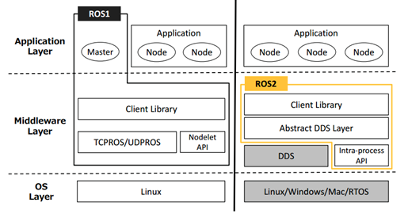
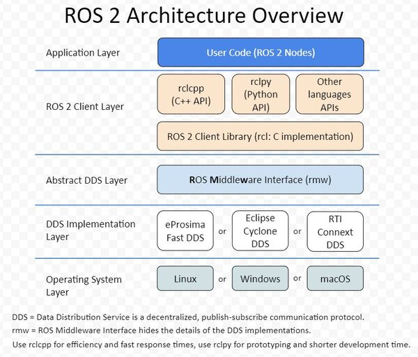
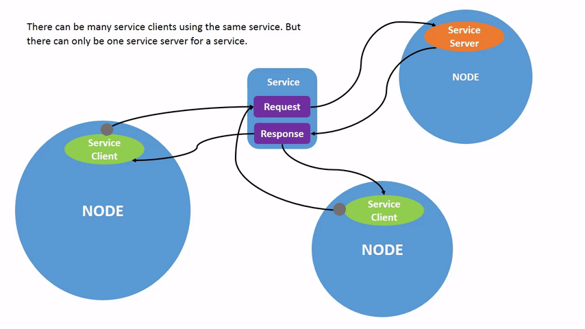

# [版本](https://docs.ros.org/)

| Ubuntu版本	| 代号	| ROS 版本 | 代号	| 发布时间 | EOL (支持结束)	| 备注 |
|------|----------|------|------|------|------|------|
|18.04 LTS |Bionic| ROS 1	Melodic	| Morenia	| 2018.05| 2023.05|ROS 2 首个官方 LTS 版本|
| || ROS 2 Dashing	| Diademata	| 2019.05	|2021.05|ROS 1 重要的 LTS 版本之一|
| || ROS 2 Eloquent	| Elusor	| 2019.11|	2020.11|	ROS 2 短期支持版本|
|20.04 LTS |Focal| ROS 1 Noetic	|Ninjemys |	2020.05	|2025.05	|ROS 1 最终版本，官方推荐|
| || **ROS 2 Foxy**|	Fitzroy	|2020.06|	2023.06|	ROS 2 首个3年LTS版本，应用广泛|
| || ROS 2 Galactic|	Geochelone|	2021.05|	2022.12|	ROS 2 短期支持版本，优化了性能|
|22.04 LTS|Jammy	|**ROS 2 Humble**	|Hawksbill|	2022.05|	2027.05|	ROS 2 首个5年LTS版本，主流选择|
| || ROS 2 Iron	|Irwini |	2023.05|	2024.11	|ROS 2 短期支持版本，引入新API |
|24.04 LTS	|Noble	|**ROS 2 Jazzy**|	Jalisco	|2024.05	|2029.05|	最新ROS 2 LTS版本，适配新系统|
|	||	ROS 2 Rolling|	Ridley|  |                |	滚动开发版，用于体验最新特性|
|26.04 LTS	|Resolute Raccoon| **[ROS2 Lyrical](https://docs.ros.org/en/lyrical/)** | Luth | 2026.05 | 2031.05 | 支持WIN11 |

> 一般根据ubuntu的版本选择对应的ROS2版本

# 下载

1. Set locale: 要求有一个可以支持 `UTF-8`的locale

   ```bash
   locale  # check for UTF-8
   
   sudo apt update && sudo apt install locales
   sudo locale-gen en_US en_US.UTF-8
   sudo update-locale LC_ALL=en_US.UTF-8 LANG=en_US.UTF-8
   export LANG=en_US.UTF-8
   
   locale  # verify settings
   ```

2. Setup Sources：添加 Ros2 apt 的仓库到系统

   - 添加 `Ubuntu Universe repository`

     ```bash
     sudo apt install software-properties-common
     sudo add-apt-repository universe
     ```

   - 添加 Ros2 仓库

     ```bash
     sudo apt update && sudo apt install curl -y
     export ROS_APT_SOURCE_VERSION=$(curl -s https://api.github.com/repos/ros-infrastructure/ros-apt-source/releases/latest | grep -F "tag_name" | awk -F'"' '{print $4}')
     curl -L -o /tmp/ros2-apt-source.deb "https://github.com/ros-infrastructure/ros-apt-source/releases/download/${ROS_APT_SOURCE_VERSION}/ros2-apt-source_${ROS_APT_SOURCE_VERSION}.$(. /etc/os-release && echo ${UBUNTU_CODENAME:-${VERSION_CODENAME}})_all.deb"
     sudo dpkg -i /tmp/ros2-apt-source.deb
     ```

3. 下载Ros2

   ```bash
   sudo apt update
   sudo apt upgrade
   sudo apt install ros-humble-desktop # sudo apt install ros-humble-ros-base
   sudo apt install ros-dev-tools
   ```

4. source 

   ```bash
   source /opt/ros/humble/setup.bash
   ```

5. 卸载

   ```bash
   sudo apt remove '~nros-humble-*' && sudo apt autoremove 
   # 卸载仓库
   sudo apt remove ros2-apt-source
   sudo apt update
   sudo apt autoremove
   sudo apt upgrade # Consider upgrading for packages previously shadowed.
   ```

# 教程

- [Tutorials — ROS 2 Documentation: Humble documentation](https://docs.ros.org/en/humble/Tutorials.html)
- [动手学ROS2](https://fishros.com/d2lros2/#/)
- [ROS2 完全教程：从原理到实践 | ros2_tutorial](https://zsc.github.io/ros2_tutorial/)

# 1 架构

## 1.1 ROS1

### 1.1.1 Master

**Master** 节点本质上是一个轻量级的名称服务器（Name Server），提供以下核心功能：

1. **名称注册与解析**：维护节点名称到网络地址的映射表, 维护了整个 ROS 计算图的“通讯录”.
   - **工作机制**：当一个 ROS 节点（Node）启动时，它会向 Master 报告自己的**节点名称**、**网络地址（URI）**，以及它要**发布（Publish）** 或**订阅（Subscribe）** 的话题（Topic）名称。Master 会将所有信息记录在内存中。
2. **服务发现**：帮助节点之间建立点对点连接
   - **工作流程（以话题通信为例）**：
     1. **发布者（Publisher）上线**：节点 A 启动，向 Master 注册，声明它将发布名为 `/camera` 的话题。
     2. **订阅者（Subscriber）上线**：节点 B 启动，向 Master 查询，表示它想订阅 `/camera` 话题。
     3. **Master“牵线”**：Master 发现 A 和 B 的需求匹配，于是将 A 的网络地址（IP 和端口）告诉 B。
     4. **节点“直连”**：节点 B 获得地址后，**直接**与节点 A 建立 TCP 连接。此后，所有的图像数据都通过这个直连链路传输，完全绕开 Master。
3. **参数服务器**：存储和分发全局配置参数
   - **工作机制**：Master 内部维护了一个全局的、基于键值对（Key-Value）的字典（Dictionary）。任何节点都可以通过 `rosparam` 等工具或 API，向这个“白板”**设置（set）**、**获取（get）** 或**删除（delete）** 参数。
   - **主要作用**：它主要用于存储系统运行时的配置参数，例如 PID 控制器的增益、相机分辨率等。这样做的好处是配置与代码分离，便于集中管理和动态调整。

```
     +----------------+
     |   ROS Master   |
     |   (roscore)    |
     +-------+--------+
             |
     +-------+--------+
     |  Name Service  |
     |   Registry     |
     +----------------+
            / | \
           /  |  \
    +-----+   |   +-----+
    |Node1|   |   |Node2|
    +-----+   |   +-----+
              |
          +-------+
          |Node3  |
          +-------+
```

**总结**：

- **“轻量级的名称服务器”** 准确描述了它**不转发数据**，只处理元数据的特性。
- **“名称注册与解析”** 是其作为“电话总机”的看家本领。
- **“服务发现”** 是实现高效 **P2P 通信** 的关键“牵线”步骤。
- **“参数服务器”** 是其提供的、用于**集中存储配置**的附加功能。

> 这三大功能共同构成了 ROS 1 计算图的核心枢纽，但其集中式的设计也带来了单点故障等架构上的局限性。

### 1.1.2 XMLRPC 协议与通信流程

ROS1 使用 XMLRPC 作为**节点**与 **Master**之间的通信协议。

**为什么是 XML-RPC？**

ROS 诞生于 2007 年左右，彼时分布式通信的选择有限。选择 XML-RPC 而非现代流行的 gRPC 或 RESTful，基于以下考量：

- **极致的轻量级**：XML-RPC 基于 HTTP 协议，传输的是纯文本的 XML 格式。它不需要复杂的序列化（如 Protobuf），库文件极小，非常契合机器人嵌入式硬件的有限资源。

- **绝佳的语言无关性**：几乎所有编程语言（C++、Python、Java、Lisp）都对 XML-RPC 有原生支持。ROS 1 希望节点可以用不同语言编写，XML-RPC 是当时实现这一目标最便捷的“最大公约数”。

- **仅用于控制信令**：设计者非常清楚，XML 文本格式解析慢、占用带宽大，所以**严格限定 XML-RPC 只传输“元数据”（名字、地址、参数），绝不传输传感器点云、图像等“大数据”**。

  

**节点启动与注册流程**：

1. 节点启动时，通过 `ROS_MASTER_URI` 环境变量(比如 “http://192.168.1.100:11311”)找到 Master

2. 当节点启动时，它会在自己的内存中初始化，但**不会**主动去 Master 注册“我是一个节点”。它只在需要对外提供功能时，才去注册：

   - 如果是发布者（Publisher），调用 **`registerPublisher()`**
   - 如果是订阅者（Subscriber），调用 **`registerSubscriber()`**
   - 如果是服务端（Service），调用 **`registerService()`**
   - Master 的注册表里存的是 **（话题名 ↔ 节点 URI）** 的映射，而不是单独的节点列表。

3. **ROS 1 的 Master 不会给节点分配任何全局递增的数值型 ID（如 UUID）**。节点的“唯一标识”就是它在启动时通过 `ros::init()` 传入的 **节点名称（Node Name）**，比如 `/camera_node`。

   > **隐藏的“抢注”机制（容易被忽视）**：如果两个节点起了一模一样的名字（例如都叫 `/camera_node`），Master 不会给第二个节点分配一个新 ID，而是会**强制踢掉（Shutdown）第一个节点**，让第二个节点顶替上去。这就是 ROS 1 著名的 **“后发先至（抢注）”** 策略。所以，所谓的“注册确认”仅仅是 Master 回复一个 `1`（成功），并没有 ID 生成。

4. 节点注册自己提供的话题/服务到 Master。

   - 当调用 `registerPublisher` 时，节点向 Master 提交的数据包包含：
     1. **话题名称**（如 `/cmd_vel`）
     2. **节点的 XML-RPC 地址**（即该节点内置的一个小型 XML-RPC 服务器的 URI，用于接收其他节点的反向连接请求）
     3. **消息类型**（如 `geometry_msgs/Twist`）
     4. **消息 MD5 校验和**（用于确保发布者和订阅者编译的是完全相同的消息定义）
   - **关键作用**：当订阅者查询时，Master 会进行 **MD5 严格匹配**。如果 MD5 对不上，Master 依然会返回发布者地址，但订阅者收到后会发现类型不匹配并报错中断，**这是 ROS 1 编译时依赖强耦合的根源**。

5. 订阅者的“反向注册”

   - 订阅者通过 Master 拿到发布者的 XML-RPC URI 后，**订阅者会作为客户端，主动去连接发布者的 XML-RPC 服务器**。
   - 订阅者调用发布者提供的 **`requestTopic()`** 方法。
   - 发布者此时会动态分配一个**空闲的 TCP 端口**，通过 XML-RPC 返回给订阅者。
   - 订阅者拿到这个 TCP 端口后，**断开 XML-RPC 连接**，转而建立 **TCPROS（二进制数据流）** 的长连接。

**话题订阅建立流程**：

```
发布者节点                Master                订阅者节点
    |                      |                      |
    |--registerPublisher-->|                      |
    |                      |<--registerSubscriber-|
    |                      |                      |
    |                      |--publisherUpdate---->|
    |<-----------------requestTopic---------------|
    |------------------TCPROS连接----------------->|
```

> XML-RPC 下的完整“三次握手”流程（工作机制）

在 ROS 1 中，Master 只是一个 XML-RPC 服务器（Server），每个节点同时也是 XML-RPC 客户端（Client）。**节点与 Master 的交互全是短连接的 HTTP 请求**，典型流程如下：

1. **注册（Publisher）**：节点 A 通过 XML-RPC 调用 Master 的 `registerPublisher` 接口，告诉 Master：“我要发 `/camera` 话题，我的 IP 是 192.168.1.1:1234”。
2. **查询（Subscriber）**：节点 B 通过 XML-RPC 调用 Master 的 `registerSubscriber` 接口，询问：“谁在发 `/camera` 话题？”
3. **解析（返回地址）**：Master 通过 XML-RPC 响应，把节点 A 的 URI（192.168.1.1:1234）返回给节点 B。

**关键转折点**：拿到地址后，节点 B 会**直接通过 XML-RPC 去请求节点 A 的 TCP 服务器端口**，协商后续数据传输的端口号。协商成功后，**节点 A 和 B 之间建立 TCPROS（基于 TCP 的二进制流）连接**，从此所有图像、激光数据走二进制通道，完全踢开 Master 和 XML-RPC。

这个过程的关键点：

- Master 只负责”牵线搭桥”，不参与数据传输
- 节点之间建立直接的 TCPROS 连接传输数据
- 这种设计降低了 Master 负载，但也引入了单点故障

### 1.1.3 TCPROS协议

1. 第一阶段：连接建立（Connection Header）—— 纯文本键值对

   当订阅者（Subscriber）通过 XML-RPC 拿到发布者（Publisher）的 IP 和端口后，会创建一个 TCP 连接。**在这个连接发送任何二进制数据之前，必须交换一次文本头（Header）。**

   - **帧结构 1：请求头（Client -> Server）**

     | 字节偏移 | 字段       | 类型              | 值示例（ASCII）   | 说明                                    |
     | :------- | :--------- | :---------------- | :---------------- | :-------------------------------------- |
     | 0 - 3    | Header长度 | `uint32_t` (小端) | `0x00000038` (56) | 后续 Header 文本的字节长度              |
     | 4 - N    | Header数据 | `char[]`          | 见下方            | 由 `key=value` 组成，用 `\0`(0x00) 分隔 |

     **Header 数据内容（必须包含的键值对）：**

     ```text
     callerid=my_subscriber_node\0
     topic=/chatter\0
     md5sum=992ce8a1687cec8c8bd883ec7395c2fb\0
     type=std_msgs/String\0
     tcp_nodelay=1\0
     ```

     > **注意**：字符串末尾没有换行符，全是 `\0` 分隔。`tcp_nodelay=1` 建议带上，用于禁用 Nagle 算法。

   - **帧结构 2：响应头（Server -> Client）**

     发布者收到请求后，校验 MD5 和类型，回复响应头。格式完全相同：

     | 字节偏移 | 字段       | 类型              | 说明                              |
     | :------- | :--------- | :---------------- | :-------------------------------- |
     | 0 - 3    | Header长度 | `uint32_t` (小端) | 通常小于 256 字节                 |
     | 4 - N    | Header数据 | `char[]`          | 包含 `md5sum`、`type`、`callerid` |

     **响应后，连接正式进入数据传输阶段**。如果 MD5 校验失败，发布者会在响应后直接发送一个 `-1` 长度的包（特殊信号）并主动关闭连接。

2. 第二阶段：数据传输（Data Layer）—— 二进制序列化

   握手结束后，**发布者开始向 TCP 连接中持续写入数据帧**。

   **帧结构（每一条消息）：**

   | 字节偏移           | 字段名           | 类型          | 字节数     | 值域                        | 详细作用                                           |
   | :----------------- | :--------------- | :------------ | :--------- | :-------------------------- | :------------------------------------------------- |
   | **0 - 3**          | **Payload 长度** | **uint32_t**  | **4 字节** | **0x00000000 ~ 0xFFFFFFFF** | **小端序**。表示后面紧跟的序列化数据占了几个字节。 |
   | **4 - (4+Length)** | **序列化数据**   | **uint8_t[]** | **可变**   | 二进制裸数据                | 具体的 ROS 消息内容，按内存顺序平铺。              |

3. 举个实际的十六进制（Hex）流例子

   假设你要发送 `std_msgs/String`，内容为 `"Hi"`：

   - ​	**计算负载长度**：字符串长度前缀（4字节）+ 实际字符（2字节）= 6字节。写入 `uint32_t` 小端：`0x06 0x00 0x00 00`。

   - **序列化消息体（Msg）**：

     先写长度 `2`：`0x02 0x00 0x00 0x00`

     再写字符 `'H'` 和 `'i'`：`0x48 0x69`

   - **所以完整的 TCP 字节流为：**
     `[06 00 00 00] [02 00 00 00] [48 69]`

> ### TCPROS 序列化格式的“隐形陷阱”（“比 Protobuf 简单?”）
>
> - **致命差异（反直觉）**：Protobuf 是**有 Schema（模式）** 的自描述格式，接收方即使没有编译 .proto 文件也能解析部分字段。但 **ROS 1 的序列化格式是完全“无头（Headerless）”的**，它只按顺序紧密排列二进制原始数据（Primitive Types）。
> - **这意味着什么？** 订阅者**必须**提前知道消息的确切结构和字段顺序。如果发布者编译的 `geometry_msgs/Twist` 和订阅者编译的版本 MD5 校验和不一致（哪怕只差一个字段名），TCP 连接虽然能建立，但订阅者反序列化时会**直接内存错位**，导致程序崩溃或读出天文数字。这就是为什么 ROS 1 编译时强依赖，且不能热更新消息定义。

**性能特征分析**：

- 延迟：局域网 < 1ms，取决于消息大小和网络状况
- 吞吐量：可达网络带宽的 80-90%（大消息）
- CPU 开销：序列化/反序列化约占 5-15%（取决于消息复杂度）

### 1.1.4 多机通信配置

在多机环境下部署 ROS1 需要careful配置：

```bash
# 机器 A (Master 所在)
export ROS_MASTER_URI=http://192.168.1.100:11311
export ROS_IP=192.168.1.100

# 机器 B (Worker 节点)
export ROS_MASTER_URI=http://192.168.1.100:11311
export ROS_IP=192.168.1.101
export ROS_HOSTNAME=worker-robot  # 可选，用于 DNS 解析
```

**网络配置检查清单**：

1. 所有机器时钟同步（NTP）
2. 防火墙开放必要端口（11311 for Master, 随机端口 for nodes）
3. 主机名解析正确（/etc/hosts 或 DNS）
4. 网络延迟 < 10ms（局域网环境）

### 1.1.5 通信机制

- ### 话题（Topics）：发布-订阅模式

  **消息传输特征**：

  - **异步通信**：发布者不等待订阅者接收

  - **多对多通信**：多个发布者和订阅者可以共享同一话题。

    > - **工程现实**：**在 TCPROS 层面，不存在“共享”总线。**
    >   如果有 N 个发布者和 M 个订阅者，Master 牵线后，底层会建立 **N × M 个独立的 TCP 长连接**。这意味着：
    >   - **资源消耗**：如果有 3 个相机节点（发布者）和 4 个视觉节点（订阅者），底层会建立 12 个 TCP 连接。端口资源和服务端 `select/poll` 的句柄数会线性增长。
    >   - **广播风暴风险**：如果某个发布者发送 1MB 的点云数据，这条数据会在 TCP 层被复制 M 份，占用 M 倍的网络带宽（而非共享内存）。

  - **无应答机制**：发布者不知道消息是否被接收

    

  **队列管理策略**：发布者和订阅者都会维护各自的队列

  - **发布者队列：管理消息发送**

    发布者队列是一个**出站（outgoing）消息队列**，主要负责：

    - **缓冲待发消息**：当`publish()`被调用时，消息会先进入这个队列等待发送。
    - **应对网络波动**：在网络不稳定或订阅者处理慢时，队列能暂存消息，避免丢失。
    - **控制内存使用**：通过`queue_size`参数限制队列长度，防止无限制增长导致内存溢出。

    当队列满了之后，再有新消息进入，最旧的消息会被丢弃。

    ```python
    # 发布者队列大小设置
    pub = rospy.Publisher('topic', MessageType, queue_size=10)
    # queue_size 影响：
    # - 太小：高频发布时可能丢失消息
    # - 太大：占用内存，增加延迟
    ```
    - **roscpp (C++) 的发布者**：当 TCP 发送缓冲区满（订阅者接收太慢）且发布队列 `queue_size` 填满时，新来的消息会**覆盖（Overwrite）队列中最旧的消息**。即：**丢弃老数据，保留新数据**（适合传感器流，雷达数据旧不如新）。
    - **rospy (Python) 的发布者（高风险）**：**在 ROS Kinetic 及更早版本中，若 `queue_size=0`，队列大小被视为无限**！如果订阅者卡住，Python 进程内存会疯狂增长直至 OOM（内存溢出）被系统杀死。在 Noetic 中，`queue_size=0` 被修正为“只存 1 条”。

  - **订阅者的回调队列**：入站（incoming）消息队列

    ```python
    rospy.Subscriber('chatter', String, callback, queue_size=10)
    ```

    - **暂存待处理消息**：接收到的消息会先存放在这里，等待回调函数（Callback）处理。
    - **解耦接收与处理**：即使回调函数处理较慢，消息也能先被接收并存放在队列中，避免丢失。
    - **控制内存使用**：同样通过`queue_size`参数限制队列长度，防止内存溢出。

    当队列满了之后，再有新消息到达，最旧的消息会被丢弃。

- ### 服务（Services）：请求-响应模式

  服务提供同步的请求-响应通信模式，适合需要确定性结果的场景。

  **服务调用流程**：

  ```
  客户端                    服务器
    |                         |
    |---请求（Request）------>|
    |                         |处理请求
    |<---响应（Response）------|
    |                         |
  ```

  **关键设计决策**：

  1. **同步阻塞**：客户端等待服务器响应
     - 默认超时时间是无穷大（`None`），意味着如果服务端没响应，客户端会**永久挂起**。
     - **生产环境必加超时**：建议在 Proxy 构造或 `call()` 时设置 `timeout`（如 `rospy.ServiceProxy('name', Srv, timeout=10)`），否则网络闪断或服务端死锁会导致整个 Node 卡死。
  2. **单次连接**：每次调用建立新的 TCP 连接
  3. **无状态**：服务器不维护客户端状态

  **性能考量**：

  ```
  服务调用开销 = 连接建立时间 + 请求传输 + 处理时间 + 响应传输
  ```

  **持久连接优化**：

  ```python
  # 使用持久连接减少开销
  from rospy import ServiceProxy
  service = ServiceProxy('service_name', ServiceType, persistent=True)
  # 重用 TCP 连接，减少握手开销
  ```

  **但需要特别注意**：如果服务端（Server）节点崩溃重启，持久连接会变为“僵尸连接”。此时调用 `service.call()` 会抛出 `ServiceException`，必须捕获异常并重新创建 `ServiceProxy` 才能恢复。

- ### 动作（Actions）：带反馈的异步任务

  适合长时间运行的任务

  **动作协议的五个组成部分**：

  1. **Goal**：任务目标
  2. **Result**：最终结果
  3. **Feedback**：执行过程中的反馈
  4. **Status**：任务状态（pending/active/succeeded/aborted）
  5. **Cancel**：取消机制

  ```
  动作内部实现 = 5个话题 + 状态机管理
             /action_name/goal        (目标发送)
             /action_name/cancel      (取消请求)
             /action_name/status      (状态更新)
             /action_name/feedback    (进度反馈)
             /action_name/result      (最终结果)
  ```

  **状态机转换图**：

  ```
          [PENDING]
              |
              v
          [ACTIVE] <---> [PREEMPTING]
           /    \              |
          v      v             v
     [SUCCEEDED] [ABORTED] [PREEMPTED]
  ```

  **设计模式应用场景**：

  - **导航任务**：发送目标点，接收路径执行反馈
  - **机械臂控制**：执行轨迹，监控执行进度
  - **感知处理**：长时间的图像处理或 SLAM 建图

### 1.1.6 Catkin

Catkin 是 ROS1 的构建系统，基于 CMake 扩展而来，解决了大规模机器人软件的构建挑战。

**核心设计目标**：

1. **包管理**：支持细粒度的功能包组织
2. **依赖管理**：自动处理包之间的依赖关系
3. **并行构建**：充分利用多核 CPU
4. **跨平台**：支持 Linux、macOS（部分）

**工作空间结构**

```
catkin_ws/
├── src/               # 源代码目录
│   ├── package1/
│   │   ├── CMakeLists.txt
│   │   ├── package.xml
│   │   ├── src/
│   │   └── include/
│   └── package2/
├── build/             # 构建中间文件
│   └── [CMake 生成的构建文件]
├── devel/             # 开发空间
│   ├── setup.bash     # 环境配置脚本
│   ├── lib/           # 编译的库文件
│   └── share/         # 资源文件
└── install/           # 安装空间（可选）
    └── [发布版本文件]
```

**CMakeLists.txt 深度解析**

```cmake
cmake_minimum_required(VERSION 3.0.2)
project(my_robot_package)

# 查找 catkin 和依赖包
find_package(catkin REQUIRED COMPONENTS
  roscpp
  std_msgs
  sensor_msgs
  geometry_msgs
)

# 声明 catkin 包
catkin_package(
  INCLUDE_DIRS include
  LIBRARIES ${PROJECT_NAME}
  CATKIN_DEPENDS roscpp std_msgs
  DEPENDS eigen3  # 系统依赖
)

# 包含目录
include_directories(
  include
  ${catkin_INCLUDE_DIRS}
)

# 编译库
add_library(${PROJECT_NAME}
  src/algorithm.cpp
)

# 编译可执行文件
add_executable(robot_node src/main.cpp)
target_link_libraries(robot_node
  ${PROJECT_NAME}
  ${catkin_LIBRARIES}
)

# 安装规则
install(TARGETS robot_node
  RUNTIME DESTINATION ${CATKIN_PACKAGE_BIN_DESTINATION}
)
```

**包依赖管理**

**package.xml 结构**：

```xml
<?xml version="1.0"?>
<package format="2">
  <name>my_robot_package</name>
  <version>1.0.0</version>
  <description>机器人控制包</description>
  
  <maintainer email="dev@robot.com">Developer</maintainer>
  <license>MIT</license>
  
  <!-- 构建依赖 -->
  <buildtool_depend>catkin</buildtool_depend>
  <build_depend>roscpp</build_depend>
  
  <!-- 运行依赖 -->
  <exec_depend>roscpp</exec_depend>
  <exec_depend>rospy</exec_depend>
  
  <!-- 测试依赖 -->
  <test_depend>rostest</test_depend>
</package>
```

**依赖解析算法**：

1. 拓扑排序确定构建顺序
2. 检测循环依赖
3. 并行构建无依赖关系的包

**构建优化技巧**

**1. 并行构建加速**：

```
# 使用所有 CPU 核心
catkin_make -j$(nproc)

# 或使用 catkin_tools（推荐）
catkin build --jobs $(nproc)
```

**2. 增量构建优化**：

```
# 只构建修改的包
catkin build --this

# 构建指定包及其依赖
catkin build package_name --deps
```

**3. ccache 加速重复编译**：

```
# 安装 ccache
sudo apt-get install ccache

# 配置 catkin 使用 ccache
export CC="ccache gcc"
export CXX="ccache g++"
```

### 1.1.7 参数服务器

ROS1 的参数服务器是一个中心化的配置存储系统，运行在 Master 节点上。它使用层次化的命名空间存储键值对。

**参数类型支持**：

- 基本类型：bool, int, double, string
- 复合类型：list, dict（嵌套结构）
- 二进制数据：base64 编码的二进制 blob

**命名空间层次结构**：

```
/
├── robot_name              # 全局参数
├── /navigation/
│   ├── max_velocity        # 导航模块参数
│   ├── planner/
│   │   ├── algorithm       # 规划器配置
│   │   └── resolution
│   └── controller/
│       └── gains           # 控制器参数
└── /perception/
    ├── camera/
    │   └── fps
    └── lidar/
        └── range
```

**参数操作 API**

- **参数读写操作**：

  ```python
  # Python API
  import rospy
  
  # 读取参数
  max_vel = rospy.get_param('/navigation/max_velocity', 1.0)  # 带默认值
  params = rospy.get_param('/navigation/')  # 获取整个命名空间
  
  # 写入参数
  rospy.set_param('/navigation/max_velocity', 2.0)
  
  # 删除参数
  rospy.delete_param('/navigation/obsolete_param')
  
  # 检查参数存在
  if rospy.has_param('/navigation/max_velocity'):
      # 参数存在
      pass
  
  # C++ API
  ros::NodeHandle nh;
  double max_vel;
  nh.getParam("/navigation/max_velocity", max_vel);
  nh.setParam("/navigation/max_velocity", 2.0);
  ```

- **私有参数与相对命名**

  ```python
  # 私有参数（节点命名空间）
  rospy.init_node('my_node')
  # 参数实际路径：/my_node/param_name
  private_param = rospy.get_param('~param_name')
  
  # 相对参数（当前命名空间）
  # 如果当前命名空间是 /robot1/
  relative_param = rospy.get_param('sensor/range')
  # 实际路径：/robot1/sensor/range
  ```

**动态重配置（Dynamic Reconfigure）**

**配置文件定义（.cfg）**：

```c++
#!/usr/bin/env python
from dynamic_reconfigure.parameter_generator_catkin import *

gen = ParameterGenerator()

# 添加参数：名称、类型、级别、描述、默认值、最小值、最大值
gen.add("max_velocity", double_t, 0, 
        "Maximum velocity", 1.0, 0.0, 5.0)
gen.add("enable_obstacle_avoidance", bool_t, 0,
        "Enable obstacle avoidance", True)

# 枚举类型
algorithm_enum = gen.enum([
    gen.const("DWA", int_t, 0, "Dynamic Window Approach"),
    gen.const("TEB", int_t, 1, "Timed Elastic Band"),
    gen.const("MPC", int_t, 2, "Model Predictive Control")
], "Planning algorithm selection")

gen.add("algorithm", int_t, 0, 
        "Path planning algorithm", 0, 0, 2, 
        edit_method=algorithm_enum)

exit(gen.generate("my_package", "my_node", "MyConfig"))
```

**节点实现动态重配置**：

```c++
#include <dynamic_reconfigure/server.h>
#include <my_package/MyConfigConfig.h>

class MyNode {
private:
    dynamic_reconfigure::Server<my_package::MyConfigConfig> server_;
    
    void configCallback(my_package::MyConfigConfig &config, uint32_t level) {
        // 更新内部参数
        max_velocity_ = config.max_velocity;
        use_obstacle_avoidance_ = config.enable_obstacle_avoidance;
        
        // 级别检查（哪些参数改变了）
        if (level & 0x1) {
            // 速度参数改变
            updateVelocityController();
        }
    }
    
public:
    MyNode() {
        // 设置回调
        server_.setCallback(
            boost::bind(&MyNode::configCallback, this, _1, _2));
    }
};
```


## 1.2 ROS2

### 1.2.1 架构



- DDS实现层：数据分发服务（Data Distribution Service, DDS）。

  DDS 的核心概念模型：

  ```
  ┌─────────────────────────────────────────────────────┐
  │                   DDS Domain                        │
  │  ┌──────────────┐              ┌──────────────┐    │
  │  │ Domain       │              │ Domain       │    │
  │  │ Participant  │◄────────────►│ Participant  │    │
  │  │              │     RTPS      │              │    │
  │  │ ┌──────────┐ │              │ ┌──────────┐ │    │
  │  │ │Publisher │ │              │ │Subscriber│ │    │
  │  │ │          │ │              │ │          │ │    │
  │  │ │┌────────┐│ │              │ │┌────────┐│ │    │
  │  │ ││DataWriter│─────Topic────►│ ││DataReader│ │    │
  │  │ │└────────┘│ │              │ │└────────┘│ │    │
  │  │ └──────────┘ │              │ └──────────┘ │    │
  │  └──────────────┘              └──────────────┘    │
  └─────────────────────────────────────────────────────┘
  ```

  1. Transport Layer：直接调用操作系统的**Socket API**（UDP/IP协议栈）
     - **多播与单播管理**：它负责在局域网内发送组播（Multicast）来寻找其他节点，同时建立单播（Unicast）通道来传输实际的大数据。
     - **共享内存（SHM）**：如果两个节点在同一台电脑上，Fast DDS会直接绕过网卡，通过**共享内存**传递数据（零拷贝），这一块逻辑完全由它自己掌控，RMW压根不知道数据是走网线还是走内存。
  2. Discovery & Topology：维护着一张巨大的**内置主题（Built-in Topics）**列表。
     - 它会在后台不停地收发RTPS（实时发布-订阅协议）的发现报文。
     - **具体工作**：它会记录当前网络里“谁发布了什么Topic”、“谁订阅了什么Topic”、“谁的IP地址是多少、端口号是多少”。这个匹配过程（称为**端点匹配 Endpoint Matching**）完全在实现层内部完成，匹配成功后，它才会建立两个节点间的“虚连接”。
  3. Serialization Engine：当调用`publish`时，数据交到实现层手上，它会立刻启动**CDR（通用数据表示）引擎**。
     - 它将C++/Python的结构体数据，**按照固定的字节序（大端/小端）打平成二进制流**。
     - **碎片化处理**：如果打平后的数据大于一个网络包（如超过1472字节），实现层会主动将其**切成多个RTPS子报文（Submessage）**，并在包头写上序号，方便接收端重组。ROS上层传下来的只是指针，它才是真正“动手拆解”数据的那个人。

  4. Reliability & QoS:发数据，它还**承诺送达质量**
     - **消息重传（NACK/ACK机制）**：当你设置QoS为`RELIABLE`时，发送端会把发过的数据存进**本地历史缓存（Writer History Cache）**。如果接收端没收到，会发回一个NACK（否定应答）信号，实现层收到后就会从历史缓存中**取出那包数据重新发送**，直到对方确认（ACK）。
     - **心跳（Heartbeat）**：即使没有数据发送，实现层内部的后台线程也会定时向对端发送空包，以确认对方“还活着”，维持连接的活性。
  5. Threading & Scheduling:实现层一旦被加载进ROS节点进程，就会**创建属于它自己的后台线程池**：
     - **接收线程**：一个专用线程一直在`recv()`系统调用上阻塞，监听网口涌入的数据包。
     - **事件线程**：处理定时器，比如重传计时器、心跳计时器。
     - **注意**：这些线程由实现层直接调度，不受ROS节点`spin()`的控制。即使你的ROS主循环卡住了，实现层的网络接收线程依然在工作，把数据存入缓存（DDS的`DataReader`缓存）里等你来取。

- 协议实时发布订阅协议（Real-Time Publish-Subscribe, RTPS）

  **RTPS 实体模型**

  - **Participant**：代表通信域中的一个应用实例
  - **Endpoint**：通信端点，包括 Writer 和 Reader
  - **GUID**：全局唯一标识符，格式为 `{prefix, entityId}`

  **发现协议（Discovery Protocol）**

  RTPS 使用两阶段发现机制

  1. 简单参与者发现协议（SPDP）
     - 使用多播定期广播 Participant 信息
     - 默认多播地址：`239.255.0.1:7400` (IPv4)
     - 发现消息包含：GUID、位置器（Locator）、QoS 等
  2. 简单端点发现协议（SEDP）
     - 在已发现的 Participant 间交换 Endpoint 信息
     - 使用可靠单播通信
     - 交换 Topic 名称、类型信息、QoS 配置

  **可靠性机制**：

  RTPS 提供多种可靠性保证

  ```
  心跳机制（Heartbeat）：
  Writer ──HB(seq_min, seq_max)──► Reader
        ◄──────ACK/NACK───────────
        ────────DATA──────────────►
  
  其中：
  - HB: 心跳消息，包含序列号范围
  - ACK: 确认接收
  - NACK: 请求重传
  ```

- DDS抽象层：RMW（ROS MiddleWare）

  ROS2 通过 RMW（ROS MiddleWare）接口抽象不同的 DDS 实现：

  ```c++
  // RMW 接口示例
  typedef struct rmw_node_t {
    const char * name;
    const char * namespace_;
    rmw_context_t * context;
    rmw_node_impl_t * impl;
  } rmw_node_t;
  
  // 创建节点的统一接口
  rmw_node_t * rmw_create_node(
    rmw_context_t * context,
    const char * name,
    const char * namespace_);
  ```

  RMW 层次结构：

  ```
  ┌─────────────┐
  │  ROS2 API   │  <- rclcpp/rclpy
  ├─────────────┤
  │     RCL     │  <- ROS Client Library
  ├─────────────┤
  │     RMW     │  <- 抽象接口层
  ├─────────────┤
  │  DDS Impl   │  <- Fast DDS/Cyclone等
  ├─────────────┤
  │   Network   │  <- UDP/共享内存
  └─────────────┘
  ```

- ROS2 客户端库 RCL

- 应用层

### 1.2.2 实时性

ROS2 实时性是指系统确定性地在指定时间内完成任务的能��。与 ROS1 相比，ROS2 在实时性方面有了显著改进，主要得益于其基于 DDS 的架构和去中心化设计。

**实时性等级分类**

| 等级 | 特征 | 典型应用 |
|------|------|----------|
| 硬实时（Hard Real-time） | 确定性延迟，有严格的时间约束 | 安全关键系统，如自动驾驶 |
| 软实时（Soft Real-time） | 统计意义上的实时，偶尔超时可接受 | 机器人感知、UI交互 |
| 非实时（Non Real-time） | 无时间约束 | 日志记录、调试工具 |

**ROS2 实时性改进**

1. **去除 Master 节点**
   - ROS1 的 Master 是单点故障，且增加通信延迟
   - ROS2 采用 DDS 去中心化架构，无单点瓶颈

2. **确定性通信**
   - DDS 提供可配置的服务质量（QoS）策略
   - `RELIABLE` 模式确保消息送达
   - `BEST_EFFORT` 模式放弃重传，降低延迟

3.节点生命周期管理**
   - ROS2 支持节点生命周期（Lifecycle）
   - 可控制节点状态转换，确保系统在确定状态下运行
   - 适用于需要严格启动顺序的安全关键系统

**实时性配置示例（C++）**

```cpp
// 配置发布者的 QoS 策略，实现实时性
rclcpp::PublisherOptionsWithAllocator<std::allocator<void>> options;
options.qos_overriding_options = rclcpp::QosOverridingOptions::with_default_policies();

// 设置实时安全的 QoS 配置
auto qos = rclcpp::QoS(rclcpp::KeepLast(10))
    .reliable()           // 确保消息送达
    .durability_volatile() // 不保留历史数据
    .deadline(rclcpp::Duration(10, 0)); // 10ms内必须送达

publisher_ = this->create_publisher<std_msgs::msg::String>("topic", qos, options);
```

**实时性测试工具**

```bash
# 使用 stress 测试系统负载
sudo apt install stress
stress --cpu 4 --io 2 --vm 1

# 使用 cyclictest 测量实时性能
sudo apt install rt-tests
cyclictest -p 80 -t 5 -D 10
```

**影响实时性的因素**

| 因素 | 说明 | 优化建议 |
|------|------|----------|
| 内存分配 | 动态分配导致不确定性 | 使用内存池、预分配 |
| 系统调度 | Linux CFS 调度器不确定性 | 使用 PREEMPT_RT 补丁 |
| 网络延迟 | UDP/TCP 传输延迟 | 使用共享内存通信 |
| 垃圾回收 | 动态语言 GC 暂停 | 减少动态对象创建 |
| 中断处理 | 硬件中断不可预测 | 使用实时线程 |

### 1.2.3 内存管理

ROS2 应用程序的内存管理对于系统的实时性和稳定性至关重要。与 ROS1 类似，ROS2 也需要谨慎处理内存分配，但得益于其现代化的架构，提供了一些改进和新特性。

**ROS2 内存管理挑战**

| 挑战 | 描述 | 影响 |
|------|------|------|
| 动态分配 | 运行时 new/delete 导致内存碎片 | 实时系统不确定延迟 |
| 消息复制 | 大消息（如点云）多次拷贝 | CPU 占用高，延迟增加 |
| 堆内存竞争 | 多线程访问堆导致锁竞争 | 性能下降 |
| 内存泄漏 | 未释放的内存导致长期运行崩溃 | 系统稳定性 |

**ROS2 内存分配机制**

ROS2 默认使用动态分配，但在实时性要求高的场景下可以使用预分配策略：

```cpp
#include <rclcpp/rclcpp.hpp>
#include <rclcpp/strategies/allocator_memory.hpp>

// 使用堆栈分配器，避免动态分配
using AllocatorType = std::allocator<void>;
using AllocatorTraits = std::allocator_traits<AllocatorType>;

// 为大消息预分配缓冲区
class PreallocatedPublisher : public rclcpp::Node {
public:
    PreallocatedPublisher() : Node("preallocated_publisher") {
        // 预分配消息缓冲区
        preallocated_msg_ = std::make_shared<sensor_msgs::msg::PointCloud2>();
        preallocated_msg_->data.reserve(1000000);  // 预分配1MB
        
        publisher_ = this->create_publisher<sensor_msgs::msg::PointCloud2>("points", 10);
    }
    
private:
    sensor_msgs::msg::PointCloud2::SharedPtr preallocated_msg_;
    rclcpp::Publisher<sensor_msgs::msg::PointCloud2>::SharedPtr publisher_;
};
```

**1. 预分配内存池**

在实时系统中，动态内存分配是延迟不确定性的主要来源。预分配内存池通过在系统启动时一次性分配所需内存，确保运行时的分配操作具有确定性时间复杂度。

```cpp
// 使用自定义分配器避免运行时分配
template<typename T, size_t POOL_SIZE>
class PoolAllocator {
  private:
    std::array<T, POOL_SIZE> pool_;
    std::bitset<POOL_SIZE> used_;
    
  public:
    using value_type = T;
    
    T* allocate(size_t n) {
        if (n != 1) {
            throw std::bad_alloc();
        }
        // O(1) 时间复杂度的分配
        for(size_t i = 0; i < POOL_SIZE; ++i) {
            if(!used_[i]) {
                used_[i] = true;
                return &pool_[i];
            }
        }
        throw std::bad_alloc();  // 池已满
    }
    
    void deallocate(T* ptr, size_t n) {
        if (n != 1) return;
        size_t index = std::distance(pool_.data(), ptr);
        if (index < POOL_SIZE) {
            used_[index] = false;
        }
    }
};

// ROS2 中使用自定义分配器
template<typename T>
using MyPoolAllocator = PoolAllocator<T, 1000>;

auto qos = rclcpp::QoS(rclcpp::KeepLast(10))
    .allocator(std::make_unique<MyPoolAllocator<void>>());

publisher_ = this->create_publisher<MyMessage>("topic", qos);
```

**内存池配置示例**

```yaml
# config.yaml
my_node:
  ros__parameters:
    use_memory_pool: true
    pool_size: 100
    message_pool_size: 50
```

**2. 零拷贝通信**

ROS2 支持通过共享内存实现零拷贝，减少数据复制开销，提高通信效率。

```
进程 A                     共享内存                    进程 B
┌──────┐                 ┌─────────┐                ┌──────┐
│Writer│───write ptr────►│ Message │◄───read ptr────│Reader│
└──────┘                 └─────────┘                └──────┘
         无需复制，直接访问同一内存区域
```

**ROS2 共享内存传输机制**

ROS2 使用 DDS 的共享内存传输（SHM）实现零拷贝：

```cpp
// 启用共享内存传输
// 在节点代码中配置
auto context = rclcpp::Context::make_shared();
auto options = rclcpp::NodeOptions()
    .context(context);

// 或者通过环境变量启用
// export RMW_IMPLEMENTATION=rmw_fastrtps_cpp
// export FASTRTPS_DEFAULT_PROFILES_FILE=/path/to/profile.xml
```

**Fast DDS 共享内存配置**

```xml
<?xml version="1.0"?>
<dds>
  <profiles xmlns="http://www.eprosima.com/XMLSchemas/fastRTPS_Profiles">
    <transport_descriptors>
      <transport_descriptor>
        <transport_id>SharedMemoryTransport</transport_id>
        <type>SHM</type>
        <maxMessageSize>0</maxMessageSize>  <!-- 0表示自动 -->
      </transport_descriptor>
    </transport_descriptors>
    
    <participantLibraryName="shm_participant">
      <domainParticipantLibraryName>shmParticipant</domainParticipantLibraryName>
      <rtps>
        <userTransports>
          <transport_id>SharedMemoryTransport</transport_id>
        </userTransports>
      </rtps>
    </participantLibraryName>
  </profiles>
</dds>
```

**消息内部分配器**

ROS2 消息支持自定义内存分配器，用于特定场景优化：

```cpp
#include <sensor_msgs/msg/point_cloud2.hpp>
#include <allocator_traits_allocator_propagation.hpp>

// 创建支持自定义分配器的发布者
auto allocator = std::make_shared<std::pmr::polymorphic_allocator<byte>>();
rclcpp::PublisherOptionsWithAllocator<sensor_msgs::msg::PointCloud2::Allocator> options;
options.allocator(allocator);

publisher_ = this->create_publisher<sensor_msgs::msg::PointCloud2>(
    "points", 
    rclcpp::QoS(rclcpp::KeepLast(10)).allocator(allocator.get()),
    options);
```

**3. 堆栈分配（避免堆分配）**

对于小消息，尽量使用栈上分配，避免堆分配：

```cpp
// 栈上分配小消息
void process_small_message() {
    // 在栈上创建消息，避免动态分配
    std_msgs::msg::String msg;
    msg.data = "small payload";
    publisher_->publish(msg);
}  // msg 自动销毁，无堆分配
```

**4. 内存泄漏检测**

```bash
# 使用 Valgrind 检测内存泄漏
valgrind --leak-check=full ros2 run package_name node_name

# 使用 AddressSanitizer 编译
colcon build --cmake-args -DCMAKE_BUILD_TYPE=Debug -DCMAKE_CXX_FLAGS="-fsanitize=address"

# 运行带有 ASAN 的节点
ros2 run --prefix "asanwrapper" package_name node_name
```

**ROS2 内存管理最佳实践**

| 实践 | 说明 | 适用场景 |
|------|------|----------|
| 预分配消息 | 避免运行时分配 | 实时系统 |
| 共享内存 | 减少数据拷贝 | 大消息传输 |
| 对象池 | 复用对象减少分配 | 高频消息 |
| 栈分配 | 小消息用栈 | 低延迟回调 |
| 避免动态字符串 | 使用固定大小数组 | 嵌入式系统 |

### 1.2.4 调度策略与优先级

Linux 操作系统提供了多种调度策略，ROS2 节点运行在其之上，了解这些调度策略对于优化机器人系统的实时性能至关重要。

**调度策略分类**

| 策略 | 名称 | 优先级范围 | 适用场景 |
|------|------|-----------|----------|
| `SCHED_FIFO` | 先进先出 | 1-99 | 实时任务，无时间片概念 |
| `SCHED_RR` | 时间片轮转 | 1-99 | 实时任务，相同优先级共享时间片 |
| `SCHED_DEADLINE` | 截止时间优先 | 1-99 | 硬实时任务，混合任务调度 |
| `SCHED_OTHER` | 完全公平调度器(CFS) | 0 | 普通任务，默认策略 |
| `SCHED_BATCH` | 批处理调度 | 0 | CPU密集型，不注重响应性 |

**优先级范围**
- **实时优先级（1-99）**：值越大优先级越高，仅限 root 用户或 CAP_SYS_NICE 能力
- **普通优先级（0）**：对应 `SCHED_OTHER`/`SCHED_BATCH`，由 CFS 调度器管理

**ROS2 线程优先级配置**

```cpp
#include <rclcpp/rclcpp.hpp>
#include <rclcpp/strategies/allocator_memory.hpp>
#include <sched.h>

// 设置线程优先级（需要 root 权限）
void set_thread_priority(pthread_t thread, int priority) {
    struct sched_param param;
    param.sched_priority = priority;
    
    // 设置调度策略为 SCHED_FIFO
    if (pthread_setschedparam(thread, SCHED_FIFO, &param) != 0) {
        RCLCPP_WARN(rclcpp::get_logger("demo"), "Failed to set thread priority");
    }
}

// 在 ROS2 回调中使用
void my_callback() {
    pthread_t current_thread = pthread_self();
    set_thread_priority(current_thread, 50);  // 设置高优先级
}
```

**ROS2 调度策略配置**

```bash
# 使用实时调度策略启动节点（需要 root 权限）
sudo chrt -f 10 ros2 run package_name node_name

# 查看进程调度策略
chrt -p <pid>

# 设置已有进程为 SCHED_RR
sudo chrt -rr 50 -p <pid>
```

**回调组调度**

ROS2 提供了回调组（Callback Groups）来管理回调的执行顺序：

```cpp
#include <rclcpp/callback_groups.hpp>

class MyNode : public rclcpp::Node {
public:
    MyNode() : Node("my_node") {
        // 创建互斥回调组
        callback_group_ = this->create_callback_group(
            rclcpp::CallbackGroupType::MutuallyExclusive);
        
        // 创建可重入回调组
        reentrant_callback_group_ = this->create_callback_group(
            rclcpp::CallbackGroupType::Reentrant);
        
        // 将订阅者添加到回调组
        subscription_ = this->create_subscription<std_msgs::msg::String>(
            "topic", 10,
            [this](const std_msgs::msg::String::SharedPtr msg) {
                // 处理消息
            },
            rclcpp::QoS(10),
            nullptr,  // CallbacksGroup
            reentrant_callback_group_);  // 回调组
    }
    
private:
    rclcpp::CallbackGroup::SharedPtr callback_group_;
    rclcpp::CallbackGroup::SharedPtr reentrant_callback_group_;
    rclcpp::Subscription<std_msgs::msg::String>::SharedPtr subscription_;
};
```

**多线程执行器**

```cpp
#include <rclcpp/executors.hpp>

int main(int argc, char** argv) {
    rclcpp::init(argc, argv);
    
    auto node = std::make_shared<MyNode>();
    
    // 创建多线程执行器
    rclcpp::executors::MultiThreadedExecutor executor;
    executor.add_node(node);
    
    // 指定线程数（默认 CPU 核心数）
    executor.spin();
    
    rclcpp::shutdown();
    return 0;
}
```

**优先级反转问题与解决方案**

优先级反转是指低优先级任务持有高优先级任务所需的资源，导致中优先级任务反而先执行的现象。

```
时间 →
T1: 高优先级任务开始，等待资源
T2: 低优先级任务获得资源，开始执行
T3: 中优先级任务抢占低优先级任务
T4: 中优先级任务执行完毕
T5: 低优先级任务继续执行，释放资源
T6: 高优先级任务获得资源，继续执行
```

**解决方案：优先级继承协议**

```cpp
#include <pthread.h>

pthread_mutex_t shared_mutex;
pthread_mutexattr_t attr;

// 设置互斥量为优先级继承模式
pthread_mutexattr_setprotocol(&attr, PTHREAD_PRIO_INHERIT);
pthread_mutex_init(&shared_mutex, &attr);

// 高优先级任务使用
void high_priority_task() {
    pthread_mutex_lock(&shared_mutex);
    // 临界区操作
    pthread_mutex_unlock(&shared_mutex);
}
```

### 1.2.5 时间抖动分析

时间抖动（Jitter）是指预期触发时间与实际触发时间之间的偏差。在机器人系统中，精确的时间控制对于传感器融合、运动控制等应用至关重要。

**抖动的来源**

| 来源 | 说明 | 影响程度 |
|------|------|----------|
| 系统调度延迟 | 任务被调度器挂起的时间 | 高 |
| 中断延迟 | 硬件中断处理时间 | 高 |
| 内存分配 | 动态分配导致的暂停 | 中 |
| 缓存未命中 | CPU 缓存失效 | 中 |
| GC 暂停 | 垃圾回收导致的停顿 | 高（Python） |
| 网络延迟 | 消息传输时间不确定 | 中 |

**抖动测量方法**

```cpp
#include <rclcpp/rclcpp.hpp>
#include <chrono>

class JitterAnalyzer {
public:
    using Clock = std::chrono::steady_clock;
    
    JitterAnalyzer() : Node("jitter_analyzer") {
        timer_ = this->create_wall_timer(
            std::chrono::milliseconds(10),
            [this]() { this->timer_callback(); });
    }
    
    void timer_callback() {
        auto now = Clock::now();
        auto expected = expected_time_.load();
        
        if (expected != Clock::time_point::min()) {
            auto jitter = std::chrono::duration_cast<std::chrono::microseconds>(
                now - expected).count();
            
            RCLCPP_INFO(this->get_logger(), "Jitter: %ld us", jitter);
            
            // 记录统计
            jitter_sum_ += jitter;
            jitter_count_++;
            jitter_max_ = std::max(jitter_max_, std::llabs(jitter));
            jitter_min_ = std::min(jitter_min_, std::llabs(jitter));
        }
        
        // 计算下一次预期触发时间
        expected_time_.store(now + std::chrono::milliseconds(10));
    }
    
    void print_statistics() {
        if (jitter_count_ > 0) {
            RCLCPP_INFO(this->get_logger(), 
                "Jitter stats - Avg: %ld us, Max: %ld us, Min: %ld us",
                jitter_sum_ / jitter_count_, jitter_max_, jitter_min_);
        }
    }
    
private:
    rclcpp::TimerBase::SharedPtr timer_;
    std::atomic<Clock::time_point> expected_time_{Clock::time_point::min()};
    int64_t jitter_sum_ = 0;
    int64_t jitter_count_ = 0;
    int64_t jitter_max_ = 0;
    int64_t jitter_min_ = LLONG_MAX;
};
```

**使用 ROS2 内置时间测量**

```bash
# 使用 ros2 topic hz 查看话题发布频率的稳定性
ros2 topic hz /topic_name

# 使用 ros2 topic delay 查看话题延迟
ros2 topic delay /topic_name

# 使用 timer_info 查看定时器抖动
# 在代码中通过 rcl_timer_t 获取 timer_info
```

**降低抖动的技术**

**1. CPU 亲和性绑定**

```bash
# 将节点绑定到特定 CPU 核心
taskset -c 2,3 ros2 run package_name node_name

# 或在代码中设置
#include <sched.h>

void set_cpu_affinity(const std::vector<int>& cpus) {
    cpu_set_t mask;
    CPU_ZERO(&mask);
    for (int cpu : cpus) {
        CPU_SET(cpu, &mask);
    }
    
    pthread_t current_thread = pthread_self();
    sched_setaffinity(current_thread, sizeof(cpu_set_t), &mask);
}
```

**2. 内存锁定**

```bash
# 锁定内存防止换页（需要 root）
sudo ulimit -l unlimited
sudo ros2 run package_name node_name
```

**3. 实时线程优先级**

```bash
# 使用实时策略运行
sudo chrt -f 99 ros2 run package_name node_name
```

**抖动分析示例输出**

```
[Jitter Analyzer] Jitter: 150 us
[Jitter Analyzer] Jitter: -80 us
[Jitter Analyzer] Jitter: 200 us
[Jitter Analyzer] Jitter: -50 us
[Jitter Analyzer] Jitter: 120 us
...
[Jitter Analyzer] Jitter stats - Avg: 45 us, Max: 200 us, Min: 50 us
```

**抖动容限参考**

| 应用场景 | 可接受抖动 | 说明 |
|----------|------------|------|
| 视觉里程计 | < 10 ms | 图像时间戳要求 |
| IMU 融合 | < 1 ms | 高频传感器融合 |
| 电机控制 | < 100 μs | 硬实时控制要求 |
| 雷达处理 | < 5 ms | 点云处理 |
| 语音交互 | < 50 ms | 人类感知阈值 |

**诊断工具**

```bash
# 使用 time 命令查看进程时间统计
/usr/bin/time -v ros2 run package_name node_name

# 查看系统调度延迟
sudo cyclictest -p 90 -t 1 -D 10 -m

# 查看内核调度统计
cat /proc/sched_debug
```


# 2 工作空间与包管理

## 2.1 工作空间结构

```text
.(工作空间)
├── build
    ├── 包1
      ├── CMakeCache.txt
      ├── Makefile
      ├── cmake_install.cmake
├── install 
    ├── 包1
        ├── lib
        ├── share
    ├── 包2
        ├── lib
        ├── share
    ├── setup.bash
    ├── setup.sh
    ├── setup.zsh
    ├── zshrc
    ├── zshrc.d
├── src
    └── 包1
        ├── src
        ├── CMakeLists.txt
        └── launch
    └── 包2
        ├── src
        ├── CMakeLists.txt
        └── launch
├── log
    ├── 包1
    ├── 包2

4 directories, 0 files
```

## 2.2 功能包获取方式

1. 安装获取
```bash
sudo apt install ros-<version>-package_name
```
此方法获取的功能包不需要source 环境变量

2. 从源代码获取
```bash
git clone https://github.com/ros2/package_name.git
```
此方法获取的功能包需要source 环境变量

3. 手动编译
```bash
cd <工作空间>
colcon build
```
此方法获取的功能包需要source 环境变量


# 3 Colcon

## 3.1 安装
```bash
sudo apt-get install python3-colcon-common-extensions
```
安装完成后，打开终端输入colcon即可看到其使用方法。
## 3.2 使用示例
1. 创建工作目录
```bash
mkdir -p ros_ws && cd ros_ws
mkdir src && cd src
```
2. 下载个ROS2示例源码
```bash
git clone https://github.com/ros2/examples src/examples -b humble
```
3. 编译全部功能包
```bash
colcon build  
```
- 编译 C++ 源码、Python 脚本、消息接口 .msg、服务 .srv、动作 .action
- 生成可执行文件、库文件、头文件、Python 包
- 默认输出目录：build/（编译中间文件）、install/（安装产物）、log/（日志）
- 编译后，会把源码里的 Python 脚本、配置文件、launch 文件、yaml 参数文件完整拷贝一份到 install/对应包/share/、install/对应包/lib/python*/site-packages/。

~痛点： 修改源码里的 .py、.launch.py、.yaml 后，不会自动生效； 必须重新执行一遍 colcon build 重新拷贝，调试极其繁琐； 频繁重复编译浪费时间.解决方案:

`colcon build --symlink-install`
  链接安装，无需source 环境变量(每次调整 python 脚本时都不必重新build了)

```bash
colcon build --packages-select YOUR_PKG_NAME  # 只编译一个包
colcon build --packages-select YOUR_PKG_NAME  --cmake-args -DBUILD_TESTING=0 #不编译测试单元
colcon test #运行编译的包的测试
```

4. 运行示例
```bash
source install/setup.bash
ros2 run examples minimal_talker
```


## 3.3 使用 RCLCPP 编写功能包

### 3.3.1 创建功能包

(1) 创建工作空间,并进入src目录
```bash
mkdir -p ros_ws && cd ros_ws
mkdir src && cd src
```
(2) 创建功能包
```bash
ros2 pkg create example_cpp --build-type ament_cmake --dependencies rclcpp
```
- `pkg create` 是创建包的意思
- --build-type 用来指定该包的编译类型，一共有三个可选项`ament_python`、`ament_cmake`、`cmake` (foxy不支持,默认为ament_cmake)
- `--dependencies` 指的是这个功能包的依赖，这里是一个ros2的C++客户端接口rclcpp

(3) 创建节点

`node_01.cpp`
```C++
#include "rclcpp/rclcpp.hpp"


int main(int argc, char **argv)
{
    /* 初始化rclcpp  */
    rclcpp::init(argc, argv);
    /*产生一个node_01的节点*/
    auto node = std::make_shared<rclcpp::Node>("node_01");
    // 打印一句自我介绍
    RCLCPP_INFO(node->get_logger(), "node_01节点已经启动.");
    /* 运行节点，并检测退出信号 Ctrl+C*/
    rclcpp::spin(node);
    /* 停止运行 */
    rclcpp::shutdown();
    return 0;
}

```
`CMakeLists.txt`
```
add_executable(node_01 src/node_01.cpp)
ament_target_dependencies(node_01 rclcpp)
install(TARGETS
  node_01
  DESTINATION lib/${PROJECT_NAME}
)
```
(4) 编译与运行
```bash
colcon build
source setup.bash
ros2 run examples_cpp node_01
```
## 3.4 使用 RCLPY 编写功能包

### 3.4.1 创建功能包

(1) 创建功能包
```bash
cd ros_ws/src
ros2 pkg create example_py --build-type ament_python --dependencies rclpy
```
创建完成后的目录结构
```text
.
├── example_py
│   └── __init__.py
├── package.xml
├── resource
│   └── example_py
├── setup.cfg
├── setup.py
└── test
    ├── test_copyright.py
    ├── test_flake8.py
    └── test_pep257.py

3 directories, 8 files
```
(2) 编写程序，创建节点
`node_02.py`
```python
import rclpy
from rclpy.node import Node

def main(args=None):
    """
    ros2运行该节点的入口函数
    编写ROS2节点的一般步骤
    1. 导入库文件
    2. 初始化客户端库
    3. 新建节点对象
    4. spin循环节点
    5. 关闭客户端库
    """
    rclpy.init(args=args) # 初始化rclpy
    node = Node("node_02")  # 新建一个节点
    node.get_logger().info("大家好，我是node_02.")
    rclpy.spin(node) # 保持节点运行，检测是否收到退出指令（Ctrl+C）
    rclpy.shutdown() # 关闭rclpy

```

`setup.py`
```
    entry_points={
        'console_scripts': [
            "node_02 = example_py.node_02:main"
        ],
    },
```

# 4 面向对象方式编写 ROS2 节点

## 4.1 C++

### 4.1.1 面向对象方式创建节点

```C++

#include "rclcpp/rclcpp.hpp"

/*
    创建一个类节点，名字叫做Node03,继承自Node.
*/
class Node03 : public rclcpp::Node
{

public:
    // 构造函数,有一个参数为节点名称
    Node03(std::string name) : Node(name)
    {
        // 打印一句
        RCLCPP_INFO(this->get_logger(), "大家好，我是%s.",name.c_str());
    }

private:
   
};

int main(int argc, char **argv)
{
    rclcpp::init(argc, argv);
    /*产生一个node_03的节点*/
    auto node = std::make_shared<Node03>("node_03");
    /* 运行节点，并检测退出信号*/
    rclcpp::spin(node);
    rclcpp::shutdown();
    return 0;
}
```

```Cmake
add_executable(node_03 src/node_03.cpp)
ament_target_dependencies(node_03 rclcpp)

install(TARGETS
  node_03
  DESTINATION lib/${PROJECT_NAME}
)
```

## 4.2 Python

### 4.2.1 面向对象方式创建节点

```python
#!/usr/bin/env python3
import rclpy
from rclpy.node import Node


class Node04(Node):
    """
    创建一个Node04节点，并在初始化时输出一个话
    """
    def __init__(self,name):
        super().__init__(name)
        self.get_logger().info("大家好，我是%s!" % name)


def main(args=None):
    rclpy.init(args=args) # 初始化rclpy
    node = Node04("node_04")  # 新建一个节点
    rclpy.spin(node) # 保持节点运行，检测是否收到退出指令（Ctrl+C）
    rclpy.shutdown() # 关闭rclpy

```
`setup.bash`
```
    entry_points={
        'console_scripts': [
            "node_02 = example_py.node_02:main",
            "node_04 = example_py.node_04:main"
        ],
    },

```

# 5 Domain_ID

在DDS中，不同逻辑网络共享物理网络的主要机制称为域(Domain) ID。

同一域上的ROS2节点可以自由地相互发现并发送消息，而不同域上的ROS2节点则不能。所有ROS2节点默认使用域ID为0。为了避免在同一网络上运行ROS2的不同计算机组之间互相干扰，应为每组设置不同的域ID。

## 5.1 Domain_ID 与 UDP 端口
DDS 的端口分配遵循 OMG DDSI-RTPS 规范，其默认端口号由以下公式计算得出：

**多播端口（用于节点发现）**：

- DiscoveryMulticastPort = 7400 + 250 * DomainId + 0

- UserMulticastPort = 7400 + 250 * DomainId + 1

**单播端口（用于与特定参与者通信）**：

- DiscoveryUnicastPort = 7400 + 250 * DomainId + 10 + 2 * ParticipantId

- UserUnicastPort = 7400 + 250 * DomainId + 11 + 2 * ParticipantId

其中，DomainId 是设置的域 ID，ParticipantId 是同一台主机上、同一域内参与者的索引（从 0 开始），用于避免同一主机内的端口冲突。


**端口计算示例**
公式中使用的默认参数如下：

- PB (Port Base) = 7400

- DG (DomainId Gain) = 250

- PG (ParticipantId Gain) = 2

- d0, d1, d2, d3 = 0, 10, 1, 11

（1）域 0 (默认)：

    - 发现多播端口 = 7400 + 250*0 + 0 = 7400
    - 用户多播端口 = 7401。
    - 域 0 中的第 1 个参与者 (ParticipantId=1)：
       发现单播端口 = 7400 + 250*0 + 10 + 2*1 = 7412
       用户单播端口 = 7400 + 250*0 + 11 + 2*1 = 7413

（2）域 1：

    - 发现多播端口 = 7400 + 250*1 + 0 = 7650，
    - 用户多播端口 = 7651。

**🚧 ROS 2 中的实际限制与建议**

虽然理论上域 ID 可以更大，但由于 UDP 端口号是 16 位无符号整数（最大 65535），可用的最高域 ID 被限制为 232。

更重要的是，操作系统会动态分配临时端口（Ephemeral Ports） 用于客户端连接，DDS 端口可能会与此范围冲突。因此，ROS 2 官方建议在以下安全范围内选择域 ID：

```test
操作系统	默认临时端口范围	推荐的安全域 ID 范围
Linux	32768 - 60999	0 - 101 和 215 - 232
macOS	49152 - 65535	0 - 166
Windows	49152 - 65535	0 - 166
```

**⚙️ 配置与管理**

在 ROS 2 中，默认域 ID 为 0。可以通过设置环境变量 ROS_DOMAIN_ID 来指定不同的域。只有域 ID 相同的 ROS 2 节点才能相互发现和通信。

例如，在终端中启动一个域 ID 为 5 的节点：

```bash
export ROS_DOMAIN_ID=5
ros2 run your_package your_node
```
此外，一些 DDS 实现（如 Fast DDS）允许通过配置文件或 API 修改端口计算中的基础参数（如 PB, DG），从而自定义端口映射，但这需要同一网络中的所有参与者进行一致配置，否则会导致无法通信。

# 6 通信

通信的原理涉及两个主要方面：`通信协议`和`通信方式`。

- 通信协议定义了数据的格式、传输方式、错误检测和纠正等规则，以确保可靠的数据传输。

- 通信方式涉及了不同的通信介质和技术，包括`网络通信`和`进程间通信（IPC）`。

## 6.1 网络通信

### 6.1.1 基础网络命令

**UDP**

例如，使用`ping`命令进行基于UDP的网络通信：

```bash
ping 192.168.0.1
fping -a -g 10.18.0.1 10.18.0.10
```

该命令将向IP地址为192.168.0.1的主机发送ICMP Echo请求，并等待接收相应的回复。

**TCP**

服务端：使用`nc`命令进行基于TCP的网络通信：

```bash
nc -l 1234 # 监听一次
nc -lk 1234  # 持续监听
```

该命令将在本地监听端口1234，并等待与之建立TCP连接的客户端。

客户端：通过在另一个终端窗口中执行以下命令，可以建立与本地1234端口的TCP连接并在连接上发送消息：

```bash
echo "Hello, TCP!" | nc 127.0.0.1 1234 # 发送一次
nc 127.0.0.1 1234 # 持续发送
```

### 6.1.2 ROS2 网络通信机制

ROS2 基于 DDS（Data Distribution Service）实现网络通信，具有去中心化、松耦合、多播发现等特性。

**ROS2 网络通信架构**

```
┌─────────────────────────────────────────────────────────────┐
│                      ROS2 应用程序                           │
├─────────────────────────────────────────────────────────────┤
│                    RCL (ROS Client Library)                 │
├─────────────────────────────────────────────────────────────┤
│                    RMW (ROS Middleware)                     │
├─────────────────────────────────────────────────────────────┤
│                    DDS Implementation                       │
│  ┌─────────────┐  ┌─────────────┐  ┌─────────────┐         │
│  │  Fast DDS   │  │  CycloneDDS │  │  ConnextDDS │         │
│  └─────────────┘  └─────────────┘  └─────────────┘         │
├─────────────────────────────────────────────────────────────┤
│              Transport Layer (UDP/TCP/SHM)                  │
└─────────────────────────────────────────────────────────────┘
```

**ROS2 网络配置**

```bash
# 查看 ROS2 网络配置
ros2 doctor

# 检查网络插件
ros2 pkg executables | grep rmw

# 设置 DDS 实现
export RMW_IMPLEMENTATION=rmw_fastrtps_cpp
# 或
export RMW_IMPLEMENTATION=rmw_cyclonedds_cpp

# 查看域 ID
echo $ROS_DOMAIN_ID

# 设置域 ID（默认 0）
export ROS_DOMAIN_ID=42
```

**QoS 策略对网络通信的影响**

| QoS 策略 | 说明 | 适用场景 |
|----------|------|----------|
| `RELIABLE` | 确保消息送达，重传丢失报文 | 关键控制指令 |
| `BEST_EFFORT` | 不重传，丢弃丢失报文 | 传感器数据流 |
| `KEEP_LAST(n)` | 保留最新 n 条消息 | 历史数据查询 |
| `KEEP_ALL` | 保留所有历史消息 | 日志记录 |
| `VOLATILE` | 不保留历史 | 实时数据 |
| `TRANSIENT_LOCAL` | 新订阅者接收历史 | 配置分发 |

**网络诊断命令**

```bash
# 查看节点间连接
ros2 node list

# 查看话题列表
ros2 topic list

# 查看服务列表
ros2 service list

# 查看发现服务器
ros2 daemon status

# 重启发现服务
ros2 daemon stop && ros2 daemon start

# 查看特定节点的信息
ros2 node info /node_name

# 查看话题带宽
ros2 topic bw /topic_name

# 查看话题延迟
ros2 topic delay /topic_name
```

### 6.1.3 多机通信配置

ROS2 多机通信通过网络发现机制实现自动组网，无需手动配置 Master。

**基础多机配置**

```bash
# 机器 A
export ROS_DOMAIN_ID=5
export ROS_DISCOVERY_SERVER=192.168.1.100:11811

# 机器 B
export ROS_DOMAIN_ID=5
export ROS_DISCOVERY_SERVER=192.168.1.100:11811

# 启动发现服务器（仅需一台机器）
ros2 run fastrtps_discovery_server fastrtps_discovery_server -i 0 -p 11811
```

**使用容器发现服务器（Container Discovery Server）**

```bash
# 在服务器上启动发现服务器
ros2 run turtlesim talker

# 在客户端配置发现服务器
export ROS_DISCOVERY_SERVER=192.168.1.100:7400
ros2 run turtlesim listener
```

**Fast DDS 配置文件**

```xml
<?xml version="1.0"?>
<dds>
  <profiles xmlns="http://www.eprosima.com/XMLSchemas/fastRTPS_Profiles">
    <participant profile_name="server_profile">
      <rtps>
        <prefix>44.53.00.5f.45.50.52.4f.53.49.4d.41</prefix>
        <defaultUnicastLocatorList>
          <locator>
            <udpv4 address="192.168.1.100" port="7412"/>
          </locator>
        </defaultUnicastLocatorList>
        <participantID>0</participantID>
      </rtps>
    </participant>
  </profiles>
</dds>
```

**网络优化配置**

```bash
# 启用共享内存传输（同机器节点通信）
export FASTRTPS_DEFAULT_PROFILES_FILE=/path/to/fastdds_config.xml

# 调整 socket 缓冲区大小
sudo sysctl -w net.core.rmem_max=26214400
sudo sysctl -w net.core.wmem_max=26214400

# 检查防火墙规则（确保 DDS 端口开放）
sudo ufw status
# DDS 默认端口：7410-7412 (域0), 7650-7652 (域1)
```

## 6.2 进程间通信

### 6.2.1 基于共享内存的 IPC

基于共享内存的 IPC 方式通过共享内存区域在同一计算机系统内的不同进程之间进行通信。在 Linux 命令行中，可以使用 `ipcs` 和 `ipcrm` 命令来管理共享内存段。

**查看和管理共享内存**

```bash
# 查看当前系统中的共享内存段
ipcs -m

# 查看信号量
ipcs -s

# 查看消息队列
ipcs -q

# 删除不再需要的共享内存段
ipcrm -m <shmid>
```

**ROS2 共享内存传输机制**

ROS2 使用 Fast DDS 的共享内存传输（Shared Memory Transport）实现同机器上进程间的高效通信：

```
┌──────────────────────────────────────────────────────┐
│                 Shared Memory (SHM)                  │
│  ┌─────────┐  ┌─────────┐  ┌─────────┐              │
│  │Segment 1│  │Segment 2│  │Segment 3│  ...         │
│  └─────────┘  └─────────┘  └─────────┘              │
└──────────────────────────────────────────────────────┘
       ↑                  ↑                  ↑
    Process A          Process B          Process C
```

**启用共享内存传输**

```cpp
// 代码中启用
auto context = rclcpp::Context::make_shared();

// 或通过环境变量
// export RMW_FASTRTPS_USE_SHARED_MEMORY=true
```

**自定义共享内存段大小**

```xml
<?xml version="1.0"?>
<dds>
  <profiles xmlns="http://www.eprosima.com/XMLSchemas/fastRTPS_Profiles">
    <transport_descriptors>
      <transport_descriptor>
        <transport_id>SharedMemoryTransport</transport_id>
        <type>SHM</type>
        <maxMessageSize>1048576</maxMessageSize>  <!-- 1MB -->
        <maxChannelSize>52428800</maxChannelSize> <!-- 50MB -->
      </transport_descriptor>
    </transport_descriptors>
  </profiles>
</dds>
```

### 6.2.2 管道（Pipe）通信

管道是 Linux 中常用的进程间通信机制，分为匿名管道和命名管道。

**匿名管道**

```bash
# 创建匿名管道
ls -l | grep ros

# 或在程序中使用
#include <unistd.h>
int pipe(int pipefd[2]);
```

**命名管道（FIFO）**

```bash
# 创建命名管道
mkfifo /tmp/my_fifo

# 在一个终端监听
cat /tmp/my_fifo

# 在另一个终端发送
echo "Hello ROS" > /tmp/my_fifo
```

### 6.2.3 消息队列

**System V 消息队列**

```bash
# 查看消息队列
ipcs -q

# 创建消息队列
ipcmk -q

# 删除消息队列
ipcrm -q <msqid>
```

### 6.2.4 ROS2 进程内通信

ROS2 优化了同进程内节点/回调间的通信效率。

**进程内通信（Intra-process Communication）**

```cpp
#include <rclcpp/rclcpp.hpp>

// 启用进程内通信
rclcpp::init(argc, argv);
auto node = rclcpp::Node::make_shared("my_node");

// 进程内发布者配置
auto publisher = node->create_publisher<std_msgs::msg::String>("topic", 10);

// 进程内订阅
auto subscription = node->create_subscription<std_msgs::msg::String>(
    "topic", 10,
    [](const std_msgs::msg::String::SharedPtr msg) {
        RCLCPP_INFO(node->get_logger(), "Received: %s", msg->data.c_str());
    });

// ROS2 自动优化同进程内通信
rclcpp::spin(node);
```

**进程内通信示意图**

```
同一进程内:
  Publisher ──────► Subscription
       (直接函数调用，无序列化/反序列化)
```

## 6.3 中间件

### 6.3.1 ROS2 DDS 中间件

ROS2 支持多种 DDS 实现作为其中间件：

| DDS 实现 | 特点 | 适用场景 |
|----------|------|----------|
| Fast DDS | 开源，默认实现 | 通用场景 |
| Cyclone DDS | 纯开源，优化性能 | 需要宽松协议的场景 |
| Connext DDS | 商业版，功能完整 | 工业级应用 |
| GurumDDS | 商业版，高性能 | 低延迟需求 |

**切换 DDS 实现**

```bash
# Fast DDS（默认）
export RMW_IMPLEMENTATION=rmw_fastrtps_cpp

# Cyclone DDS
export RMW_IMPLEMENTATION=rmw_cyclonedds_cpp

# Connext（需要安装）
export RMW_IMPLEMENTATION=rmw_connext_cpp
```

### 6.3.2 ZeroMQ

[ZeroMQ](https://zeromq.org/) 是一个轻量级的消息队列库，提供进程内、进程间、TCP 和多播等多种消息传输模式。

```cpp
// ZeroMQ 发布者
#include <zmq.hpp>

zmq::context_t context(1);
zmq::socket_t publisher(context, zmq::socket_type::pub);
publisher.bind("tcp://*:5555");

std::string message = "Hello ROS";
publisher.send(zmq::message_t(message.data(), message.size()));

// ZeroMQ 订阅者
zmq::socket_t subscriber(context, zmq::socket_type::sub);
subscriber.connect("tcp://localhost:5555");
subscriber.set(zmq::sockopt::subscribe, "");

zmq::message_t received;
subscriber.recv(received);
std::string data(static_cast<char*>(received.data()), received.size());
```

**ZeroMQ 套接字类型**

| 类型 | 说明 | 对应模式 |
|------|------|----------|
| `PUB/SUB` | 发布-订阅 | 一对多 |
| `REQ/REP` | 请求-响应 | 同步对话 |
| `PUSH/PULL` | 管道 | 负载均衡 |
| `PAIR` | 双向握手 | 点对点 |

### 6.3.3 PyZmq

[PyZmq](https://pypi.org/project/pyzmq/) 是 ZeroMQ 的 Python 绑定。

```python
import zmq

# 发布者
context = zmq.Context()
publisher = context.socket(zmq.PUB)
publisher.bind("tcp://*:5555")

while True:
    message = "Sensor data"
    publisher.send_string(message)

# 订阅者
subscriber = context.socket(zmq.SUB)
subscriber.connect("tcp://localhost:5555")
subscriber.setsockopt_string(zmq.SUBSCRIBE, "")

while True:
    message = subscriber.recv_string()
    print(f"Received: {message}")
```

### 6.3.4 常用中间件对比

| 特性 | ROS2/DDS | ZeroMQ | MQTT |
|------|----------|--------|------|
| 服务发现 | 内置 | 无 | Broker 依赖 |
| QoS 支持 | 丰富 | 无 | 基础 |
| 持久化 | 支持 | 无 | 支持 |
| 自动重连 | 支持 | 无 | Broker 依赖 |
| 内存效率 | 高 | 极高 | 中 |
| 开发复杂度 | 中 | 低 | 低 |
| 适用规模 | 中大型 | 小型 | IoT 场景 |


# 7 ROS2中的通信

[rclcpp](https://docs.ros2.org/latest/api/rclcpp/namespacerclcpp.html)


## 7.1 话题(Topic)

一个节点发布数据到某个话题上，另外一个节点就可以通过订阅话题拿到数据。

> **一个有多个发布者，和多个订阅者** 。

**读取话题**

1. GUI: 
   - `rqt_graph`

2. CLI:
   - `ros2 topic list -t`
   -  `ros2 topic echo </话题名称>`
   - `ros2 topic info  /chatter` 查看主题类型比如`std_msgs/msg/String`，发布者和订阅者数量
   - `ros2 interface show std_msgs/msg/String`  查看里面有什么
   - `ros2 topic pub /chatter std_msgs/msg/String 'data: "123"'` 手动发布命令

**创建/订阅话题**

- CPP

  - 发布者

    `topic_publisher_01.cpp`

    ```cpp
    #include "rclcpp/rclcpp.hpp"
    #include "std_msgs/msg/string.hpp" // 新加消息类头文件
    
    class TopicPublisher01 : public rclcpp::Node
    {
    public:
        // 构造函数,有一个参数为节点名称
        TopicPublisher01(std::string name) : Node(name)
        {
            RCLCPP_INFO(this->get_logger(), "大家好，我是%s.", name.c_str());
            // 创建发布者
            command_publisher_ = this->create_publisher<std_msgs::msg::String>("command", 10);
            // 创建定时器，500ms为周期，定时发布
            timer_ = this->create_wall_timer(std::chrono::milliseconds(500), std::bind(&TopicPublisher01::timer_callback, this));
        }
    
    private:
        void timer_callback()
        {
            // 创建消息
            std_msgs::msg::String message;
            message.data = "forward";
            // 日志打印
            RCLCPP_INFO(this->get_logger(), "Publishing: '%s'", message.data.c_str());
            // 发布消息
            command_publisher_->publish(message);
        }
        // 声名定时器指针
        rclcpp::TimerBase::SharedPtr timer_;
        // 声明话题发布者指针
        rclcpp::Publisher<std_msgs::msg::String>::SharedPtr command_publisher_;
    };
    
    int main(int argc, char **argv)
    {
        rclcpp::init(argc, argv);
        /*创建对应节点的共享指针对象*/
        auto node = std::make_shared<TopicPublisher01>("topic_publisher_01");
        /* 运行节点，并检测退出信号*/
        rclcpp::spin(node);
        rclcpp::shutdown();
        return 0;
    }
    ```

  - 订阅者

    `topic_publisher_01.cpp`

    ```c++
    #include "rclcpp/rclcpp.hpp"
    #include "std_msgs/msg/string.hpp"
    
    class TopicPublisher01 : public rclcpp::Node
    {
    public:
        // 构造函数,有一个参数为节点名称
        TopicPublisher01(std::string name) : Node(name)
        {
            RCLCPP_INFO(this->get_logger(), "大家好，我是%s.", name.c_str());
            // 创建发布者
            command_publisher_ = this->create_publisher<std_msgs::msg::String>("command", 10);
            // 创建定时器，500ms为周期，定时发布
            timer_ = this->create_wall_timer(std::chrono::milliseconds(500), std::bind(&TopicPublisher01::timer_callback, this));
        }
    
    private:
        void timer_callback()
        {
            // 创建消息
            std_msgs::msg::String message;
            message.data = "forward";
            // 日志打印
            RCLCPP_INFO(this->get_logger(), "Publishing: '%s'", message.data.c_str());
            // 发布消息
            command_publisher_->publish(message);
        }
        // 声名定时器指针
        rclcpp::TimerBase::SharedPtr timer_;
        // 声明话题发布者指针
        rclcpp::Publisher<std_msgs::msg::String>::SharedPtr command_publisher_;
    };
    
    int main(int argc, char **argv)
    {
        rclcpp::init(argc, argv);
        /*创建对应节点的共享指针对象*/
        auto node = std::make_shared<TopicSubscribe01>("topic_subscribe_01");
        /* 运行节点，并检测退出信号*/
        rclcpp::spin(node);
        rclcpp::shutdown();
        return 0;
    }
    ```

  - 配置

    `CMakeLists.txt`

    ```cmake
    find_package(std_msgs REQUIRED) # 新加依赖
    
    add_executable(topic_publisher_01 src/topic_publisher_01.cpp)
    ament_target_dependencies(topic_publisher_01 rclcpp std_msgs)
    install(TARGETS
      topic_publisher_01
      DESTINATION lib/${PROJECT_NAME}
    )
    
    add_executable(topic_subscribe_01 src/topic_subscribe_01.cpp)
    ament_target_dependencies(topic_subscribe_01 rclcpp std_msgs)
    install(TARGETS
      topic_subscribe_01
      DESTINATION lib/${PROJECT_NAME}
    )
    ```

    `packages.xml`

    ```xml
    <buildtool_depend>ament_cmake</buildtool_depend>
    <depend>rclcpp</depend>
    <depend>std_msgs</depend> # 加上依赖
    <test_depend>ament_lint_auto</test_depend>
    <test_depend>ament_lint_common</test_depend>
    ```

  - 手动发布`topic`信息

    ```bash
    ros2 topic pub /command std_msgs/msg/String "{data: forward}"
    ```

- Python

  - 发布者

    `topic_publisher_02.py`

    ```cpp
    #!/usr/bin/env python3
    import rclpy
    from rclpy.node import Node
    from std_msgs.msg import String
    
    class NodePublisher02(Node):
        def __init__(self,name):
            super().__init__(name)
            self.get_logger().info("大家好，我是%s!" % name)
            self.command_publisher_ = self.create_publisher(String,"command", 10) 
            self.timer = self.create_timer(0.5, self.timer_callback)
        def timer_callback(self):
            """
            定时器回调函数
            """
            msg = String()
            msg.data = 'backup'
            self.command_publisher_.publish(msg) 
            self.get_logger().info(f'发布了指令：{msg.data}')    #打印一下发布的数据
    
    def main(args=None):
        rclpy.init(args=args) # 初始化rclpy
        node = NodePublisher02("topic_publisher_02")  # 新建一个节点
        rclpy.spin(node) # 保持节点运行，检测是否收到退出指令（Ctrl+C）
        rclpy.shutdown() # 关闭rclpy
    
    ```

  - 订阅者

    `touch topic_subscribe_02.py`

    ```c++
    #!/usr/bin/env python3
    import rclpy
    from rclpy.node import Node
    from std_msgs.msg import String
    
    class NodeSubscribe02(Node):
        def __init__(self,name):
            super().__init__(name)
            self.get_logger().info("大家好，我是%s!" % name)
            # 创建订阅者
            self.command_subscribe_ = self.create_subscription(String,"command",self.command_callback,10)
        def command_callback(self,msg):
            speed = 0.0
            if msg.data=="backup":
                speed = -0.2
            self.get_logger().info(f'收到[{msg.data}]命令，发送速度{speed}')
    
    def main(args=None):
        rclpy.init(args=args) # 初始化rclpy
        node = NodeSubscribe02("topic_subscribe_02")  # 新建一个节点
        rclpy.spin(node) # 保持节点运行，检测是否收到退出指令（Ctrl+C）
        rclpy.shutdown() # 关闭rclpy
    ```

  - `setup.py`

    ```python
    entry_points={
        'console_scripts': [
            "topic_publisher_02 = example_topic_rclpy.topic_publisher_02:main",
            "topic_subscribe_02 = example_topic_rclpy.topic_subscribe_02:main"
        ],
    },
    ```

- 其他指令

  - `ros2 topic bw /rosout` 展示话题的带宽
  - `ros2 topic delay /rosout` 展示话题的延时
  - `ros2 topic echo /rosout` 打印话题
  - `ros2 topic find rcl_interfaces/msg/Log` 展示给定类型的话题
  - `ros2 topic hz /rosout` 展示话题的平均发送频率
  - `ros2 topic info /rosout` 展示话题的信息
  - `ros2 topic list` 展示话题
  - `ros2 topic pub` 手动发布话题
  - `ros2 topic type` 展示话题的类型

## 7.2 服务 (Service)





- 同一个服务（名称相同）有且只能有一个节点来提供
- 同一个服务可以被多个客户端调用

**读取服务**

- `ros2 service list`  查询有哪些服务
- `ros2 service type /add_two_ints`查看服务的接口
- `ros2 service find example_interfaces/srv/AddTwoInts` 查看使用接口的服务

- `ros2 interface show example_interfaces/srv/AddTwoInts` 查看接口定义

**创建/订阅 服务**

- **CPP**

  -  `service_client_01.cpp`

    ```cpp
    #include "rclcpp/rclcpp.hpp"
    #include "example_interfaces/srv/add_two_ints.hpp"
    
    class ServiceClient01 : public rclcpp::Node
    {
    public:
      // 构造函数,有一个参数为节点名称
      ServiceClient01(std::string name) : Node(name)
      {
        RCLCPP_INFO(this->get_logger(), "节点已启动：%s.", name.c_str());
        // 创建客户端
        client_ = this->create_client<example_interfaces::srv::AddTwoInts>("add_two_ints_srv");
      }
    
      void send_request(int a, int b)
      {
        RCLCPP_INFO(this->get_logger(), "计算%d+%d", a, b);
    
        // 1.等待服务端上线
        while (!client_->wait_for_service(std::chrono::seconds(1)))
        {
          // 等待时检测rclcpp的状态
          if (!rclcpp::ok())
          {
            RCLCPP_ERROR(this->get_logger(), "等待服务的过程中被打断...");
            return;
          }
          RCLCPP_INFO(this->get_logger(), "等待服务端上线中");
        }
    
        // 2.构造请求的
        auto request =
            std::make_shared<example_interfaces::srv::AddTwoInts_Request>();
        request->a = a;
        request->b = b;
    
        // 3.发送异步请求，然后等待返回，返回时调用回调函数
        client_->async_send_request(
            request, std::bind(&ServiceClient01::result_callback_, this,
                               std::placeholders::_1));
      };
    
    private:
      // 声明客户端
      rclcpp::Client<example_interfaces::srv::AddTwoInts>::SharedPtr client_;
    
      void result_callback_(
          rclcpp::Client<example_interfaces::srv::AddTwoInts>::SharedFuture
              result_future)
      {
        auto response = result_future.get();
        RCLCPP_INFO(this->get_logger(), "计算结果：%ld", response->sum);
      }
    };
    
    int main(int argc, char **argv)
    {
      rclcpp::init(argc, argv);
      /*创建对应节点的共享指针对象*/
      auto node = std::make_shared<ServiceClient01>("service_client_01");
      /* 运行节点，并检测退出信号*/
      // 增加这一行，node->send_request(5, 6);，计算5+6结果
      node->send_request(5, 6);
      rclcpp::spin(node);
      rclcpp::shutdown();
      return 0;
    }
    
    ```

  - `service_server_01.cpp`

    ```cpp
    #include "rclcpp/rclcpp.hpp"
    #include "example_interfaces/srv/add_two_ints.hpp"
    
    class ServiceServer01 : public rclcpp::Node
    {
    public:
      ServiceServer01(std::string name) : Node(name)
      {
        RCLCPP_INFO(this->get_logger(), "节点已启动：%s.", name.c_str());
        // 创建服务
        add_ints_server_ =
            this->create_service<example_interfaces::srv::AddTwoInts>(
                "add_two_ints_srv",
                std::bind(&ServiceServer01::handle_add_two_ints, this,
                          std::placeholders::_1, std::placeholders::_2));
      }
    
    private:
      // 声明一个服务
      rclcpp::Service<example_interfaces::srv::AddTwoInts>::SharedPtr
          add_ints_server_;
    
      // 收到请求的处理函数
      void handle_add_two_ints(
          const std::shared_ptr<example_interfaces::srv::AddTwoInts::Request> request,
          std::shared_ptr<example_interfaces::srv::AddTwoInts::Response> response)
      {
        RCLCPP_INFO(this->get_logger(), "收到a: %ld b: %ld", request->a,
                    request->b);
        response->sum = request->a + request->b;
      };
    };
    
    int main(int argc, char **argv)
    {
      rclcpp::init(argc, argv);
      auto node = std::make_shared<ServiceServer01>("service_server_01");
      rclcpp::spin(node);
      rclcpp::shutdown();
      return 0;
    }
    ```

  - `CMakeLists.txt`

    ```cmake
    find_package(example_interfaces REQUIRED)
    
    ament_target_dependencies(service_client_01 rclcpp example_interfaces)
    
    ament_target_dependencies(service_server_01 rclcpp example_interfaces)
    ```

  - `packages.xml`

    ```xml
    <depend>example_interfaces</depend>
    ```

- **Python**

  - `service_client_02.py`

    ```python
    #!/usr/bin/env python3
    import rclpy
    from rclpy.node import Node
    from example_interfaces.srv import AddTwoInts
    
    class ServiceClient02(Node):
        def __init__(self,name):
            super().__init__(name)
            self.get_logger().info("节点已启动：%s!" % name)
            self.client_ = self.create_client(AddTwoInts,"add_two_ints_srv") 
        def result_callback_(self, result_future):
            response = result_future.result()
            self.get_logger().info(f"收到返回结果：{response.sum}")
        
        def send_request(self, a, b):
            while rclpy.ok() and self.client_.wait_for_service(1)==False:
                self.get_logger().info(f"等待服务端上线....")
                
            request = AddTwoInts.Request()
            request.a = a
            request.b = b
            self.client_.call_async(request).add_done_callback(self.result_callback_)
    
    
    def main(args=None):
        rclpy.init(args=args) # 初始化rclpy
        node = ServiceClient02("service_client_02")  # 新建一个节点
        # 调用函数发送请求
        node.send_request(3,4)
        rclpy.spin(node) # 保持节点运行，检测是否收到退出指令（Ctrl+C）
        rclpy.shutdown() # 关闭rclpy
    
    ```

  - `service_server_02.py`

    ```python
    #!/usr/bin/env python3
    import rclpy
    from rclpy.node import Node
    from example_interfaces.srv import AddTwoInts
    
    class ServiceServer02(Node):
        def __init__(self,name):
            super().__init__(name)
            self.get_logger().info("节点已启动：%s!" % name)
            self.add_ints_server_ = self.create_service(AddTwoInts,"add_two_ints_srv", self.handle_add_two_ints) 
        def handle_add_two_ints(self,request, response):
            self.get_logger().info(f"收到请求，计算{request.a} + {request.b}")
            response.sum = request.a + request.b
            return response
        
    def main(args=None):
        rclpy.init(args=args) # 初始化rclpy
        node = ServiceServer02("service_server_02")  # 新建一个节点
        rclpy.spin(node) # 保持节点运行，检测是否收到退出指令（Ctrl+C）
        rclpy.shutdown() # 关闭rclpy
    ```

  - `setup.py`

    ```python
    entry_points={
        'console_scripts': [
            'service_server_02 = example_service_rclpy.service_server_02:main',
            'service_client_02 = example_service_rclpy.service_client_02:main',
        ],
    },
    ```

## 7.3 动作(Actor)


- 目标：即Action客户端告诉服务端要做什么，服务端针对该目标要有响应。解决了不能确认服务端接收并处理目标问题
- 反馈：即Action服务端告诉客户端此时做的进度如何（类似与工作汇报）。解决执行过程中没有反馈问题
- 结果：即Action服务端最终告诉客户端其执行结果，结果最后返回，用于表示任务最终执行情况。

> 参数是由服务构建出来了，而Action是由话题和服务共同构建出来的（一个Action = 三个服务+两个话题） 三个服务分别是：1.目标传递服务 2.结果传递服务 3.取消执行服务; 两个话题：1.反馈话题（服务发布，客户端订阅） 2.状态话题（服务端发布，客户端订阅）

**命令**

- `ros2 action list -t` 获取目前系统中的action列表
- `ros2 interface show turtlesim/action/RotateAbsolute ` 获取接口的信息
- `ros2 action info /turtle1/rotate_absolute ` 查看action信息
- `ros2 action send_goal /turtle1/rotate_absolute turtlesim/action/RotateAbsolute "{theta: 1.6}"` 发送action指令；`--feedback` 获得实时反馈；


**创建Action接口**

- 创建功能包

  ```shell
  ros2 pkg create robot_control_interfaces --build-type ament_cmake
  ```

- 创建接口文件

  ```shell
  mkdir -p src/robot_control_interfaces/action
  touch src/robot_control_interfaces/action/MoveRobot.action
  ```

- `packages.xml`

  ```xml
  <depend>rosidl_default_generators</depend>
  <member_of_group>rosidl_interface_packages</member_of_group>
  ```

- `CMakeLists.txt`

  ```cmake
  find_package(ament_cmake REQUIRED)
  find_package(rosidl_default_generators REQUIRED)
  rosidl_generate_interfaces(${PROJECT_NAME}
    "action/MoveRobot.action"
  )
  ```

- 编写接口

  ```
  # Goal: 要移动的距离
  float32 distance
  ---
  # Result: 最终的位置
  float32 pose
  ---
  # Feedback: 中间反馈的位置和状态
  float32 pose
  uint32 status
  uint32 STATUS_MOVEING = 3
  uint32 STATUS_STOP = 4
  ```

- 编译

  ```shell
  colcon build --packages-select robot_control_interfaces
  ```

​	编译成功后，即可看到C++头文件和Python相关文件

​	C++ Action消息头文件目录`install/robot_control_interfaces/include`

​	Python Action消息文件目录`install/robot_control_interfaces/local/lib/python3.10`

**Cpp**

- `robot.cpp`

  ```Cpp
  #include "example_action_rclcpp/robot.h"
  
  /*移动一小步，请间隔500ms调用一次*/
  float Robot::move_step() {
    int direct = move_distance_ / fabs(move_distance_);
    float step = direct * fabs(target_pose_ - current_pose_) *
                 0.1; /* 每一步移动当前到目标距离的1/10*/
    current_pose_ += step;
    std::cout << "移动了：" << step << "当前位置：" << current_pose_ << std::endl;
    return current_pose_;
  }
  
  /*移动一段距离*/
  bool Robot::set_goal(float distance) {
    move_distance_ = distance;
    target_pose_ += move_distance_;
  
    /* 当目标距离和当前距离大于0.01同意向目标移动 */
    if (close_goal()) {
      status_ = MoveRobot::Feedback::STATUS_STOP;
      return false;
    }
    status_ = MoveRobot::Feedback::STATUS_MOVEING;
    return true;
  }
  
  float Robot::get_current_pose() { return current_pose_; }
  int Robot::get_status() { return status_; }
  /*是否接近目标*/
  bool Robot::close_goal() { return fabs(target_pose_ - current_pose_) < 0.01; }
  void Robot::stop_move() {
    status_ = MoveRobot::Feedback::STATUS_STOP;
  } /*停止移动*/
  ```

- `action_robot.cpp`

  ```cpp
  #include "example_action_rclcpp/robot.h"
  #include "rclcpp/rclcpp.hpp"
  #include "rclcpp_action/rclcpp_action.hpp"
  #include "robot_control_interfaces/action/move_robot.hpp"
  
  class ActionRobot01 : public rclcpp::Node {
   public:
    using MoveRobot = robot_control_interfaces::action::MoveRobot;
    using GoalHandleMoveRobot = rclcpp_action::ServerGoalHandle<MoveRobot>;
  
    explicit ActionRobot01(std::string name) : Node(name) {
      RCLCPP_INFO(this->get_logger(), "节点已启动：%s.", name.c_str());
  
      using namespace std::placeholders;  // NOLINT
  
      this->action_server_ = rclcpp_action::create_server<MoveRobot>(
          this, "move_robot",
          std::bind(&ActionRobot01::handle_goal, this, _1, _2),
          std::bind(&ActionRobot01::handle_cancel, this, _1),
          std::bind(&ActionRobot01::handle_accepted, this, _1));
    }
  
   private:
    Robot robot;
    rclcpp_action::Server<MoveRobot>::SharedPtr action_server_;
  
    rclcpp_action::GoalResponse handle_goal(
        const rclcpp_action::GoalUUID& uuid,
        std::shared_ptr<const MoveRobot::Goal> goal) {
      RCLCPP_INFO(this->get_logger(), "Received goal request with distance %f",
                  goal->distance);
      (void)uuid;
      if (fabs(goal->distance > 100)) {
        RCLCPP_WARN(this->get_logger(), "目标距离太远了，本机器人表示拒绝！");
        return rclcpp_action::GoalResponse::REJECT;
      }
      RCLCPP_INFO(this->get_logger(),
                  "目标距离%f我可以走到，本机器人接受，准备出发！",
                  goal->distance);
      return rclcpp_action::GoalResponse::ACCEPT_AND_EXECUTE;
    }
  
    rclcpp_action::CancelResponse handle_cancel(
        const std::shared_ptr<GoalHandleMoveRobot> goal_handle) {
      RCLCPP_INFO(this->get_logger(), "Received request to cancel goal");
      (void)goal_handle;
      robot.stop_move(); /*认可取消执行，让机器人停下来*/
      return rclcpp_action::CancelResponse::ACCEPT;
    }
  
    void execute_move(const std::shared_ptr<GoalHandleMoveRobot> goal_handle) {
      const auto goal = goal_handle->get_goal();
      RCLCPP_INFO(this->get_logger(), "开始执行移动 %f 。。。", goal->distance);
  
      auto result = std::make_shared<MoveRobot::Result>();
      rclcpp::Rate rate = rclcpp::Rate(2);
      robot.set_goal(goal->distance);
      while (rclcpp::ok() && !robot.close_goal()) {
        robot.move_step();
        auto feedback = std::make_shared<MoveRobot::Feedback>();
        feedback->pose = robot.get_current_pose();
        feedback->status = robot.get_status();
        goal_handle->publish_feedback(feedback);
        /*检测任务是否被取消*/
        if (goal_handle->is_canceling()) {
          result->pose = robot.get_current_pose();
          goal_handle->canceled(result);
          RCLCPP_INFO(this->get_logger(), "Goal Canceled");
          return;
        }
        RCLCPP_INFO(this->get_logger(), "Publish Feedback"); /*Publish feedback*/
        rate.sleep();
      }
  
      result->pose = robot.get_current_pose();
      goal_handle->succeed(result);
      RCLCPP_INFO(this->get_logger(), "Goal Succeeded");
    }
  
    void handle_accepted(const std::shared_ptr<GoalHandleMoveRobot> goal_handle) {
      using std::placeholders::_1;
      std::thread{std::bind(&ActionRobot01::execute_move, this, _1), goal_handle}
          .detach();
    }
  };
  
  
  int main(int argc, char** argv) {
    rclcpp::init(argc, argv);
    auto action_server = std::make_shared<ActionRobot01>("action_robot_01");
    rclcpp::spin(action_server);
    rclcpp::shutdown();
    return 0;
  }
  
  ```

- `control.cpp`

  ```Cpp
  #include "rclcpp/rclcpp.hpp"
  #include "rclcpp_action/rclcpp_action.hpp"
  #include "robot_control_interfaces/action/move_robot.hpp"
  
  class ActionControl01 : public rclcpp::Node {
   public:
    using MoveRobot = robot_control_interfaces::action::MoveRobot;
    using GoalHandleMoveRobot = rclcpp_action::ClientGoalHandle<MoveRobot>;
  
    explicit ActionControl01(
        std::string name,
        const rclcpp::NodeOptions& node_options = rclcpp::NodeOptions())
        : Node(name, node_options) {
      RCLCPP_INFO(this->get_logger(), "节点已启动：%s.", name.c_str());
  
      this->client_ptr_ =
          rclcpp_action::create_client<MoveRobot>(this, "move_robot");
  
      this->timer_ =
          this->create_wall_timer(std::chrono::milliseconds(500),
                                  std::bind(&ActionControl01::send_goal, this));
    }
  
    void send_goal() {
      using namespace std::placeholders;
  
      this->timer_->cancel();
  
      if (!this->client_ptr_->wait_for_action_server(std::chrono::seconds(10))) {
        RCLCPP_ERROR(this->get_logger(),
                     "Action server not available after waiting");
        rclcpp::shutdown();
        return;
      }
  
      auto goal_msg = MoveRobot::Goal();
      goal_msg.distance = 10;
  
      RCLCPP_INFO(this->get_logger(), "Sending goal");
  
      auto send_goal_options =
          rclcpp_action::Client<MoveRobot>::SendGoalOptions();
      send_goal_options.goal_response_callback =
          std::bind(&ActionControl01::goal_response_callback, this, _1);
      send_goal_options.feedback_callback =
          std::bind(&ActionControl01::feedback_callback, this, _1, _2);
      send_goal_options.result_callback =
          std::bind(&ActionControl01::result_callback, this, _1);
      this->client_ptr_->async_send_goal(goal_msg, send_goal_options);
    }
  
   private:
    rclcpp_action::Client<MoveRobot>::SharedPtr client_ptr_;
    rclcpp::TimerBase::SharedPtr timer_;
  
    void goal_response_callback(GoalHandleMoveRobot::SharedPtr goal_handle) {
      if (!goal_handle) {
        RCLCPP_ERROR(this->get_logger(), "Goal was rejected by server");
      } else {
        RCLCPP_INFO(this->get_logger(),
                    "Goal accepted by server, waiting for result");
      }
    }
  
    void feedback_callback(
        GoalHandleMoveRobot::SharedPtr,
        const std::shared_ptr<const MoveRobot::Feedback> feedback) {
      RCLCPP_INFO(this->get_logger(), "Feedback current pose:%f", feedback->pose);
    }
  
    void result_callback(const GoalHandleMoveRobot::WrappedResult& result) {
      switch (result.code) {
        case rclcpp_action::ResultCode::SUCCEEDED:
          break;
        case rclcpp_action::ResultCode::ABORTED:
          RCLCPP_ERROR(this->get_logger(), "Goal was aborted");
          return;
        case rclcpp_action::ResultCode::CANCELED:
          RCLCPP_ERROR(this->get_logger(), "Goal was canceled");
          return;
        default:
          RCLCPP_ERROR(this->get_logger(), "Unknown result code");
          return;
      }
  
      RCLCPP_INFO(this->get_logger(), "Result received: %f", result.result->pose);
      // rclcpp::shutdown();
    }
  };  // class ActionControl01
  // class ActionControl01
  
  int main(int argc, char** argv) {
    rclcpp::init(argc, argv);
    auto action_client = std::make_shared<ActionControl01>("action_robot_cpp");
    rclcpp::spin(action_client);
    rclcpp::shutdown();
    return 0;
  }
  
  ```

**Python**

- `robot.py`

  ```python
  from robot_control_interfaces.action import MoveRobot
  import math
  
  class Robot():
      """机器人类，模拟一个机器人"""
  
      def __init__(self) -> None:
          self.current_pose_ = 0.0
          self.target_pose_ = 0.0
          self.move_distance_ = 0.0
          self.status_ = MoveRobot.Feedback
  
      def get_status(self):
          """获取状态"""
          return self.status_
  
      def get_current_pose(self):
          """获取当前位置"""
          return self.current_pose_
  
      def close_goal(self):
          """接近目标"""
          return math.fabs(self.target_pose_ - self.current_pose_) < 0.01
  
      def stop_move(self):
          """停止移动"""
          self.status_ = MoveRobot.Feedback.STATUS_STOP
  
      def move_step(self):
          """移动一小步"""
          direct = self.move_distance_ / math.fabs(self.move_distance_)
          step = direct * math.fabs(self.target_pose_ - self.current_pose_) * 0.1
          self.current_pose_ += step  # 移动一步
          print(f"移动了：{step}当前位置：{self.current_pose_}")
          return self.current_pose_
  
      def set_goal(self, distance):
          """设置目标"""
          self.move_distance_ = distance
          self.target_pose_ += distance  # 更新目标位置
  
          if self.close_goal():
              self.stop_move()
              return False
  
          self.status_ = MoveRobot.Feedback.STATUS_MOVEING  # 更新状态为移动
          return True
  
  ```

  

- `action_robot.py`

  ```python
  #!/usr/bin/env python3
  
  import time
  # 导入rclpy相关库
  import rclpy
  from rclpy.node import Node
  from rclpy.action import ActionServer
  from rclpy.action.server import ServerGoalHandle
  # 导入接口
  from robot_control_interfaces.action import MoveRobot
  # 导入机器人类
  from example_action_rclpy.robot import Robot
  #from rclpy.executors import MultiThreadedExecutor
  #from rclpy.callback_groups import MutuallyExclusiveCallbackGroup
  
  class ActionRobot02(Node):
      """机器人端Action服务"""
  
      def __init__(self,name):
          super().__init__(name)
          self.get_logger().info(f"节点已启动：{name}!")
  
          self.robot_ = Robot()
  
          self.action_server_ = ActionServer(
              self, MoveRobot, 'move_robot', self.execute_callback
              # ,callback_group=MutuallyExclusiveCallbackGroup()
          )
  
      def execute_callback(self, goal_handle: ServerGoalHandle):
          """执行回调函数,若采用默认handle_goal函数则会自动调用"""
          self.get_logger().info('执行移动机器人')
          feedback_msg = MoveRobot.Feedback()
          self.robot_.set_goal(goal_handle.request.distance)
  
          # rate = self.create_rate(2)
          while rclpy.ok() and not self.robot_.close_goal():
              # move
              self.robot_.move_step()
              # feedback
              feedback_msg.pose = self.robot_.get_current_pose()
              feedback_msg.status = self.robot_.get_status()
              goal_handle.publish_feedback(feedback_msg)
              # cancel check
              if goal_handle.is_cancel_requested:
                  result = MoveRobot.Result()
                  result.pose = self.robot_.get_current_pose()
                  return result
              # rate.sleep() # Rate会造成死锁，单线程执行器时不能使用
              time.sleep(0.5)
  
          goal_handle.succeed()
          result = MoveRobot.Result()
          result.pose = self.robot_.get_current_pose()
          return result
  
          
  def main(args=None):
      """主函数"""
      rclpy.init(args=args)
      action_robot_02 = ActionRobot02("action_robot_02")
      # 采用多线程执行器解决rate死锁问题
      # executor = MultiThreadedExecutor()
      # executor.add_node(action_robot_02)
      # executor.spin()
      rclpy.spin(action_robot_02)
      rclpy.shutdown()
  
  ```

  

- `action_control.py`

  ```python
  import rclpy
  from rclpy.action import ActionClient
  from rclpy.node import Node
  # 导入Action接口
  from robot_control_interfaces.action import MoveRobot
  
  class ActionControl02(Node):
      """Action客户端"""
  
      def __init__(self, name):
          super().__init__(name)
          self.get_logger().info(f"节点已启动：{name}!")
          self.action_client_ = ActionClient(self, MoveRobot, 'move_robot')
          self.send_goal_timer_ = self.create_timer(1, self.send_goal)
  
      def send_goal(self):
          """发送目标"""
          self.send_goal_timer_.cancel()
          goal_msg = MoveRobot.Goal()
          goal_msg.distance = 5.0
          self.action_client_.wait_for_server()
          self._send_goal_future = self.action_client_.send_goal_async(goal_msg,
                                                                       feedback_callback=self.feedback_callback)
          self._send_goal_future.add_done_callback(self.goal_response_callback)
  
      def goal_response_callback(self, future):
          """收到目标处理结果"""
          goal_handle = future.result()
          if not goal_handle.accepted:
              self.get_logger().info('Goal rejected :(')
              return
          self.get_logger().info('Goal accepted :)')
          self._get_result_future = goal_handle.get_result_async()
          self._get_result_future.add_done_callback(self.get_result_callback)
  
      def get_result_callback(self, future):
          """获取结果反馈"""
          result = future.result().result
          self.get_logger().info(f'Result: {result.pose}')
  
      def feedback_callback(self, feedback_msg):
          """获取回调反馈"""
          feedback = feedback_msg.feedback
          self.get_logger().info(f'Received feedback: {feedback.pose}')
  
  
  def main(args=None):
      """主函数"""
      rclpy.init(args=args)
      action_robot_02 = ActionControl02("action_control_02")
      rclpy.spin(action_robot_02)
      rclpy.shutdown()
  
  ```

  

## 7.4 参数(Parameters)

**A parameter is a configuration value of a node. You can think of parameters as node settings.**

**组成成分**

ROS2参数是由键值对**(name : value)** 组成。

name : string

value有多种

- bool/bool[]
- int64/int64[]
- float64/float64[]
- string/string[]
- byte[]

**命令**

- `ros param list` 查看所有打开的节点的参数；

- `ros2 param describe <node_name> <param_name>` 查看参数的含义

- `ros2 param get /turtlesim background_b` 获取参数的值

- `ros2 param set <node_name> <parameter_name> <value>` 临时设置参数，重启节点恢复

- `ros2 param dump <node_name>` 将当前所有参数记录为yaml格式

- `ros2 param load  /turtlesim ./turtlesim.yaml` 载入yaml格式参数运行

- `ros2 run <package_name> <executable_name> --ros-args --params-file <file_name>` 载入参数运行


**CPP**

```c++
#include <chrono>
#include "rclcpp/rclcpp.hpp"

class ParametersBasicNode : public rclcpp::Node{
  public:
    explicit ParametersBasicNode(std::string name): Node(name){
      RCLCPP_INFO(this->get_logger(),"节点已经启动:%s.",name.c_str());
      this->declare_parameter("rcl_log_level", 0);     /*声明参数*/
      this->get_parameter("rcl_log_level", log_level); /*获取参数*/
      /*设置日志级别*/
      this->get_logger().set_level((rclcpp::Logger::Level)log_level);
      using namespace std::literals::chrono_literals;
      timer_ = this->create_wall_timer(
          500ms, std::bind(&ParametersBasicNode::timer_callback, this));
    }
  private:
    int log_level;
    rclcpp::TimerBase::SharedPtr timer_;
    void timer_callback() {
      this->get_parameter("rcl_log_level", log_level); /*获取参数*/
      /*设置日志级别*/
      this->get_logger().set_level((rclcpp::Logger::Level)log_level);
      std::cout<<"======================================================"<<std::endl;
      RCLCPP_DEBUG(this->get_logger(), "我是DEBUG级别的日志，我被打印出来了!");
      RCLCPP_INFO(this->get_logger(), "我是INFO级别的日志，我被打印出来了!");
      RCLCPP_WARN(this->get_logger(), "我是WARN级别的日志，我被打印出来了!");
      RCLCPP_ERROR(this->get_logger(), "我是ERROR级别的日志，我被打印出来了!");
      RCLCPP_FATAL(this->get_logger(), "我是FATAL级别的日志，我被打印出来了!");
  }
};

int main(int argc,char** argv){
  rclcpp::init(argc,argv);
  auto node = std::make_shared<ParametersBasicNode>("parameters_basic");
  rclcpp::spin(node);
  rclcpp::shutdown();
  return 0;
}
```

**Python**

```python
#!/usr/bin/env python3
import rclpy
from rclpy.node import Node

class ParametersBasicNode(Node):
    def __init__(self, name):
        super().__init__(name)
        self.get_logger().info(f"节点已启动：{name}!")
        # 声明参数
        self.declare_parameter('rcl_log_level', 0)
        # 获取参数
        log_level = self.get_parameter("rcl_log_level").value
        # 设置参数
        self.get_logger().set_level(log_level)
        # 定时修改
        self.timer = self.create_timer(0.5, self.timer_callback)

    def timer_callback(self):
        """定时器回调函数"""
        # 获取参数
        log_level = self.get_parameter("rcl_log_level").value
        # 设置参数
        self.get_logger().set_level(log_level)
        print(
            f"========================{log_level}=============================")
        self.get_logger().debug("我是DEBUG级别的日志，我被打印出来了!")
        self.get_logger().info("我是INFO级别的日志，我被打印出来了!")
        self.get_logger().warn("我是WARN级别的日志，我被打印出来了!")
        self.get_logger().error("我是ERROR级别的日志，我被打印出来了!")
        self.get_logger().fatal("我是FATAL级别的日志，我被打印出来了!")

def main(args=None):
    rclpy.init(args=args) # 初始化rclpy
    node = ParametersBasicNode("parameters_basic")  # 新建一个节点
    rclpy.spin(node) # 保持节点运行，检测是否收到退出指令（Ctrl+C）
    rclpy.shutdown() # 关闭rclpy

```

# 8 接口(interface)

## 8.1 官方接口

首先查看有哪些接口包：`ros2 interface packages`

```bash
yi@DESKTOP-9FJML7G:~$ ros2 interface packages
action_msgs
action_tutorials_interfaces
actionlib_msgs
bond
```

再看接口包里有哪些接口：`ros2 interface package sensor_msgs`

```bash
yi@DESKTOP-9FJML7G:~$ ros2 interface package sensor_msgs # sensor_msgs 接口包下的所有接口
sensor_msgs/msg/CameraInfo 
sensor_msgs/msg/ChannelFloat32
sensor_msgs/msg/NavSatStatus
```

`ros2 interface list` 展示接口

```bash
yi@DESKTOP-9FJML7G:~$ ros2 interface list
Messages:
    action_msgs/msg/GoalInfo
    action_msgs/msg/GoalStatus
    action_msgs/msg/GoalStatusArray
Services:
    action_msgs/srv/CancelGoal
    cartographer_ros_msgs/srv/FinishTrajectory
    cartographer_ros_msgs/srv/GetTrajectoryStates
```

## 8.2 接口形式

- 话题接口：`xxx.msg`

  ```c++
  int64 num
  ```

- 服务接口: `xxx.srv`

  ```c++
  int64 a
  int64 b
  ---
  int64 sum
  ```

- 动作接口:`xxx.action`

  ```c++
  int32 order
  ---
  int32[] sequence
  ---
  int32[] partial_sequence
  ```

> `msg、srv、action`文件通过 ROS2 的`IDL`模块 产生了Python和C++头文件。有了头文件，就可以在程序里导入并使用这个消息模块。

## 8.3 编写

**接口文件**

- 创建功能包

  ```bash
  ros2 pkg create example_ros2_interfaces --build-type ament_cmake --dependencies rosidl_default_generators geometry_msgs
  ```

  - 注意功能包类型必须为：`ament_cmake`
  - 依赖`rosidl_default_generators`必须添加，`geometry_msgs`视内容情况添加（这里有`geometry_msgs/Pose pose`所以要添加）。
  - 话题接口放到`msg`文件夹下，以`.msg`结尾。服务接口放到`srv`文件夹下，以`srv`结尾。

- 定义接口

  - 服务接口`MoveRobot.srv`

    ```
    # 前进后退的距离
    float32 distance
    ---
    # 当前的位置
    float32 pose
    ```

  - 话题接口，采用基础类型 `RobotStatus.msg`

    ```
    uint32 STATUS_MOVEING = 1
    uint32 STATUS_STOP = 1
    uint32  status
    float32 pose
    ```

  - 话题接口，混合包装类型 `RobotPose.msg`

    ```shell
    uint32 STATUS_MOVEING = 1
    uint32 STATUS_STOP = 2
    uint32  status
    geometry_msgs/Pose pose
    ```

- 修改 `CMakeLists.txt`

  ```cmake
  find_package(rosidl_default_generators REQUIRED)
  find_package(geometry_msgs REQUIRED)
  # 添加下面的内容
  rosidl_generate_interfaces(${PROJECT_NAME}
    "msg/RobotPose.msg"
    "msg/RobotStatus.msg"
    "srv/MoveRobot.srv"
    DEPENDENCIES geometry_msgs
  )
  ```

- 修改`package.xml`

  ```xml
    <buildtool_depend>ament_cmake</buildtool_depend>
  
    <depend>rosidl_default_generators</depend>
    <depend>geometry_msgs</depend>
    
    <member_of_group>rosidl_interface_packages</member_of_group> #添加这一行
  
    <test_depend>ament_lint_auto</test_depend>
    <test_depend>ament_lint_common</test_depend>
  
  ```

- 编译

  ```bash
  colcon build --packages-select example_ros2_interfaces
  ```

**C++调用**

`control`

```cpp
#include "rclcpp/rclcpp.hpp"
#include "example_ros2_interfaces/srv/move_robot.hpp"
#include "example_ros2_interfaces/msg/robot_status.hpp"

class ExampleInterfacesControl : public rclcpp::Node
{
public:
  ExampleInterfacesControl(std::string name) : Node(name)
  {
    RCLCPP_INFO(this->get_logger(), "节点已启动：%s.", name.c_str());
    /*创建move_robot客户端*/
    client_ = this->create_client<example_ros2_interfaces::srv::MoveRobot>(
        "move_robot");
    /*订阅机器人状态话题*/
    robot_status_subscribe_ = this->create_subscription<example_ros2_interfaces::msg::RobotStatus>("robot_status", 10, std::bind(&ExampleInterfacesControl::robot_status_callback_, this, std::placeholders::_1));
  }

  /**
   * @brief 发送移动机器人请求函数
   * 步骤：1.等待服务上线
   *      2.构造发送请求
   *
   * @param distance
   */
  void move_robot(float distance)
  {
    RCLCPP_INFO(this->get_logger(), "请求让机器人移动%f", distance);

    /*等待服务端上线*/
    while (!client_->wait_for_service(std::chrono::seconds(1)))
    {
      // 等待时检测rclcpp的状态
      if (!rclcpp::ok())
      {
        RCLCPP_ERROR(this->get_logger(), "等待服务的过程中被打断...");
        return;
      }
      RCLCPP_INFO(this->get_logger(), "等待服务端上线中");
    }

    // 构造请求
    auto request =
        std::make_shared<example_ros2_interfaces::srv::MoveRobot::Request>();
    request->distance = distance;

    // 发送异步请求，然后等待返回，返回时调用回调函数
    client_->async_send_request(
        request, std::bind(&ExampleInterfacesControl::result_callback_, this,
                           std::placeholders::_1));
  };

private:
  // 声明客户端
  rclcpp::Client<example_ros2_interfaces::srv::MoveRobot>::SharedPtr client_;
  rclcpp::Subscription<example_ros2_interfaces::msg::RobotStatus>::SharedPtr robot_status_subscribe_;
  /* 机器人移动结果回调函数 */
  void result_callback_(
      rclcpp::Client<example_ros2_interfaces::srv::MoveRobot>::SharedFuture
          result_future)
  {
    auto response = result_future.get();
    RCLCPP_INFO(this->get_logger(), "收到移动结果：%f", response->pose);
  }

  /**
   * @brief 机器人状态话题接收回调函数
   *
   * @param msg
   */
  void robot_status_callback_(const example_ros2_interfaces::msg::RobotStatus::SharedPtr msg)
  {
    RCLCPP_INFO(this->get_logger(), "收到状态数据位置：%f 状态：%d", msg->pose, msg->status);
  }
};

int main(int argc, char **argv)
{
  rclcpp::init(argc, argv);
  auto node = std::make_shared<ExampleInterfacesControl>("example_interfaces_control_01");
  /*这里调用了服务，让机器人向前移动5m*/
  node->move_robot(5.0);
  rclcpp::spin(node);
  rclcpp::shutdown();
  return 0;
}

```

`robot`

```cpp
#include "example_ros2_interfaces/msg/robot_status.hpp"
#include "example_ros2_interfaces/srv/move_robot.hpp"
#include "rclcpp/rclcpp.hpp"

class Robot
{
public:
  Robot() = default;
  ~Robot() = default;
  /**
   * @brief 移动指定的距离
   *
   * @param distance
   * @return float
   */
  float move_distance(float distance)
  {
    status_ = example_ros2_interfaces::msg::RobotStatus::STATUS_MOVEING;
    target_pose_ += distance;
    // 当目标距离和当前距离大于0.01则持续向目标移动
    while (fabs(target_pose_ - current_pose_) > 0.01)
    {
      // 每一步移动当前到目标距离的1/10
      float step = distance / fabs(distance) * fabs(target_pose_ - current_pose_) * 0.1;
      current_pose_ += step;
      std::cout << "移动了：" << step << "当前位置：" << current_pose_ << std::endl;
      // 当前线程休眠500ms
      std::this_thread::sleep_for(std::chrono::milliseconds(500));
    }
    status_ = example_ros2_interfaces::msg::RobotStatus::STATUS_STOP;
    return current_pose_;
  }
  /**
   * @brief Get the current pose
   *
   * @return float
   */
  float get_current_pose() { return current_pose_; }

  /**
   * @brief Get the status
   *
   * @return int
   *  1 example_ros2_interfaces::msg::RobotStatus::STATUS_MOVEING
   *  2 example_ros2_interfaces::msg::RobotStatus::STATUS_STOP
   */
  int get_status() { return status_; }

private:
  // 声明当前位置
  float current_pose_ = 0.0;
  // 目标距离
  float target_pose_ = 0.0;
  int status_ = example_ros2_interfaces::msg::RobotStatus::STATUS_STOP;
};

class ExampleInterfacesRobot : public rclcpp::Node
{
public:
  ExampleInterfacesRobot(std::string name) : Node(name)
  {
    RCLCPP_INFO(this->get_logger(), "节点已启动：%s.", name.c_str());
    /*创建move_robot服务*/
    move_robot_server_ = this->create_service<example_ros2_interfaces::srv::MoveRobot>(
        "move_robot", std::bind(&ExampleInterfacesRobot::handle_move_robot, this, std::placeholders::_1, std::placeholders::_2));
    /*创建发布者*/
    robot_status_publisher_ = this->create_publisher<example_ros2_interfaces::msg::RobotStatus>("robot_status", 10);
    /*创建一个周期为500ms的定时器*/
    timer_ = this->create_wall_timer(std::chrono::milliseconds(500), std::bind(&ExampleInterfacesRobot::timer_callback, this));
  }

private:
  Robot robot;                                                                                     /*实例化机器人*/
  rclcpp::TimerBase::SharedPtr timer_;                                                             /*定时器，用于定时发布机器人位置*/
  rclcpp::Service<example_ros2_interfaces::srv::MoveRobot>::SharedPtr move_robot_server_;          /*移动机器人服务*/
  rclcpp::Publisher<example_ros2_interfaces::msg::RobotStatus>::SharedPtr robot_status_publisher_; /*发布机器人位姿发布者*/

  /**
   * @brief 500ms 定时回调函数，
   *
   */
  void timer_callback()
  {
    // 创建消息
    example_ros2_interfaces::msg::RobotStatus message;
    message.status = robot.get_status();
    message.pose = robot.get_current_pose();
    RCLCPP_INFO(this->get_logger(), "Publishing: %f", robot.get_current_pose());
    // 发布消息
    robot_status_publisher_->publish(message);
  };

  /**
   * @brief 收到话题数据的回调函数
   *
   * @param request 请求共享指针，包含移动距离
   * @param response 响应的共享指针，包含当前位置信息
   */
  void handle_move_robot(const std::shared_ptr<example_ros2_interfaces::srv::MoveRobot::Request> request,
                         std::shared_ptr<example_ros2_interfaces::srv::MoveRobot::Response> response)
  {
    RCLCPP_INFO(this->get_logger(), "收到请求移动距离：%f，当前位置：%f", request->distance, robot.get_current_pose());
    robot.move_distance(request->distance);
    response->pose = robot.get_current_pose();
  };
};

int main(int argc, char **argv)
{
  rclcpp::init(argc, argv);
  auto node = std::make_shared<ExampleInterfacesRobot>("example_interfaces_robot_01");
  rclcpp::spin(node);
  rclcpp::shutdown();
  return 0;
}
```

`CMakeLists.txt`

```cmake
find_package(ament_cmake REQUIRED)
find_package(rclcpp REQUIRED)
find_package(example_ros2_interfaces REQUIRED)

add_executable(example_interfaces_robot_01 src/example_interfaces_robot_01.cpp)
target_include_directories(example_interfaces_robot_01 PUBLIC
  $<BUILD_INTERFACE:${CMAKE_CURRENT_SOURCE_DIR}/include>
  $<INSTALL_INTERFACE:include>)
target_compile_features(example_interfaces_robot_01 PUBLIC c_std_99 cxx_std_17)  # Require C99 and C++17
ament_target_dependencies(
  example_interfaces_robot_01
  "rclcpp"
  "example_ros2_interfaces"
)

install(TARGETS example_interfaces_robot_01
  DESTINATION lib/${PROJECT_NAME})


add_executable(example_interfaces_control_01 src/example_interfaces_control_01.cpp)
target_include_directories(example_interfaces_control_01 PUBLIC
  $<BUILD_INTERFACE:${CMAKE_CURRENT_SOURCE_DIR}/include>
  $<INSTALL_INTERFACE:include>)
target_compile_features(example_interfaces_control_01 PUBLIC c_std_99 cxx_std_17)  # Require C99 and C++17
ament_target_dependencies(
  example_interfaces_control_01
  "rclcpp"
  "example_ros2_interfaces"
)

install(TARGETS example_interfaces_control_01
  DESTINATION lib/${PROJECT_NAME})
```

**Python调用**

**创建节点**

```shell
cd chapt3_ws/
ros2 pkg create example_interfaces_rclpy --build-type ament_python --dependencies rclpy example_ros2_interfaces --destination-directory src --node-name example_interfaces_robot_02
touch src/example_interfaces_rclpy/example_interfaces_rclpy/example_interfaces_control_02.py
```

**编写setup.py**

```shell
entry_points={
        'console_scripts': [
            'example_interfaces_control_02 = example_interfaces_rclpy.example_interfaces_control_02:main',
            'example_interfaces_robot_02 = example_interfaces_rclpy.example_interfaces_robot_02:main'
        ],
    },
```

**control**

```python
#!/usr/bin/env python3
import rclpy
from rclpy.node import Node
from example_ros2_interfaces.msg import RobotStatus
from example_ros2_interfaces.srv import MoveRobot


class ExampleInterfacesControl02(Node):
    def __init__(self,name):
        super().__init__(name)
        self.get_logger().info("节点已启动：%s!" % name)
        self.client_ = self.create_client(MoveRobot,"move_robot") 
        self.robot_status_subscribe_ = self.create_subscription(RobotStatus,"robot_status",self.robot_status_callback,10)

    def robot_status_callback(self,msg):
        self.get_logger().info(f"收到状态数据位置：{msg.pose} 状态：{msg.status}")

    def move_result_callback_(self, result_future):
        response = result_future.result()
        self.get_logger().info(f"收到返回结果：{response.pose}")

    def move_robot(self, distance):
        while rclpy.ok() and self.client_.wait_for_service(1)==False:
            self.get_logger().info(f"等待服务端上线....")
        request = MoveRobot.Request()
        request.distance = distance
        self.get_logger().info(f"请求服务让机器人移动{distance}")
        self.client_.call_async(request).add_done_callback(self.move_result_callback_)


def main(args=None):
    rclpy.init(args=args) # 初始化rclpy
    node = ExampleInterfacesControl02("example_interfaces_control_02")  # 新建一个节点
    node.move_robot(5.0) #移动5米
    rclpy.spin(node) # 保持节点运行，检测是否收到退出指令（Ctrl+C）
    rclpy.shutdown() # 关闭rclpy


```

**robot**

```python
#!/usr/bin/env python3
import rclpy
from rclpy.node import Node
from example_ros2_interfaces.srv import MoveRobot
from example_ros2_interfaces.msg import RobotStatus
import math
from time import sleep

class Robot():
    def __init__(self) -> None:
        self.current_pose_ = 0.0
        self.target_pose_ = 0.0
        self.status_ = RobotStatus.STATUS_STOP

    def get_status(self):
        return self.status_

    def get_current_pose(self):
        return self.current_pose_

    def move_distance(self,distance):
        self.status_ = RobotStatus.STATUS_MOVEING # 更新状态为移动、
        self.target_pose_ += distance # 更新目标位置

        while math.fabs(self.target_pose_ - self.current_pose_) > 0.01:
            step = distance / math.fabs(distance) * math.fabs(self.target_pose_ - self.current_pose_) * 0.1 # 计算一步移动距离
            self.current_pose_  += step # 移动一步
            print(f"移动了：{step}当前位置：{self.current_pose_}")
            sleep(0.5) #休息0.5s
        self.status_ = RobotStatus.STATUS_STOP # 更新状态为停止
        return self.current_pose_    

class ExampleInterfacesRobot02(Node):
    def __init__(self,name):
        super().__init__(name)
        self.get_logger().info("节点已启动：%s!" % name)
        self.robot = Robot()
        self.move_robot_server_ = self.create_service(MoveRobot,"move_robot", self.handle_move_robot) 
        self.robot_status_publisher_ = self.create_publisher(RobotStatus,"robot_status", 10) 
        self.publisher_timer_ = self.create_timer(0.5, self.publisher_timer_callback)
    

    def publisher_timer_callback(self):
        """
        定时器回调发布数据函数
        """
        msg = RobotStatus() #构造消息
        msg.status = self.robot.get_status()
        msg.pose = self.robot.get_current_pose()
        self.robot_status_publisher_.publish(msg) # 发布消息
        self.get_logger().info(f'发布了当前的状态：{msg.status} 位置：{msg.pose}')

    def handle_move_robot(self,request, response):
        self.robot.move_distance(request.distance)
        response.pose = self.robot.get_current_pose()
        return response
        
def main(args=None):
    rclpy.init(args=args) # 初始化rclpy
    node = ExampleInterfacesRobot02("example_interfaces_robot_02")  # 新建一个节点
    rclpy.spin(node) # 保持节点运行，检测是否收到退出指令（Ctrl+C）
    rclpy.shutdown() # 关闭rclpy

```

# 9 数据录制与回放

## 9.1 ros2 bag 基础命令

### 9.1.1 录制话题

```bash
# 录制单个话题
ros2 bag record -o bag_file_name /topic_name

# 录制多个话题
ros2 bag record -o bag_file_name /topic1 /topic2 /topic3

# 录制所有话题
ros2 bag record -a -o bag_file_name

# 指定录制时长（秒）
ros2 bag record -o bag_file_name /topic --duration 60

# 限制文件大小（MB）
ros2 bag record -o bag_file_name /topic --max-bag-size 100
```

### 9.1.2 查看 bag 信息

```bash
# 查看 bag 文件信息
ros2 bag info bag_file.db3

# 详细信息（包括消息数量、持续时间等）
ros2 bag info bag_file.db3 -v

# 导出 bag 信息为 YAML
ros2 bag info bag_file.db3 --yaml > bag_info.yaml
```

### 9.1.3 回放数据

```bash
# 基本播放
ros2 bag play bag_file.db3

# 倍速播放（2倍速）
ros2 bag play bag_file.db3 -r 2

# 循环播放
ros2 bag play bag_file.db3 -l

# 播放单个话题
ros2 bag play bag_file.db3 --topics /topic_name

# 从指定时间开始播放
ros2 bag play bag_file.db3 --start-offset 10.0

# 暂停/恢复播放
# 在播放过程中按空格键暂停，再按恢复
```

## 9.2 ros2 bag 高级用法

### 9.2.1 条件录制

```bash
# 只录制消息数量
ros2 bag record -o bag_file /topic --max-messages 1000

# 录制时添加前缀（区分不同来源）
ros2 bag record -o bag_file /topic --prefix "test_"

# 压缩录制
ros2 bag record -o bag_file /topic --compression-algo lz4
```

### 9.2.2 录制配置

```bash
# 使用 QoS 录制（默认使用发布者的 QoS）
ros2 bag record /topic --qos-profile-overrides-path qos.yaml

# 指定 ROS_DOMAIN_ID
ros2 bag record -o bag_file /topic --ros-domain-id 42
```

### 9.2.3 bag 文件管理

```bash
# 压缩已有 bag 文件
ros2 bag compress -i bag_file.db3 -o compressed_bag.db3 --compression-algo lz4

# 解压 bag 文件
ros2 bag decompress -i compressed_bag.db3 -o decompressed_bag.db3

# 合并多个 bag 文件
ros2 bag merge bag1.db3 bag2.db3 -o merged_bag.db3

# 修复损坏的 bag 文件
ros2 bag fix bag_file.db3 -o fixed_bag.db3
```

## 9.3 数据分析工具

### 9.3.1 使用 Python 分析 bag

```python
import rclpy
from rclpy.serialization import deserialize_message
from rosidl_runtime_py import get_interface
import sqlite3

class BagAnalyzer:
    def __init__(self, bag_path):
        self.bag_path = bag_path
        self.conn = sqlite3.connect(bag_path)
        
    def get_topics(self):
        """获取 bag 中的所有话题"""
        cursor = self.conn.cursor()
        cursor.execute("SELECT DISTINCT topic_name FROM messages")
        return [row[0] for row in cursor.fetchall()]
    
    def get_message_count(self, topic_name):
        """获取指定话题的消息数量"""
        cursor = self.conn.cursor()
        cursor.execute(
            "SELECT COUNT(*) FROM messages WHERE topic_name = ?",
            (topic_name,)
        )
        return cursor.fetchone()[0]
    
    def get_messages(self, topic_name, limit=None):
        """获取指定话题的所有消息"""
        cursor = self.conn.cursor()
        query = "SELECT timestamp, message FROM messages WHERE topic_name = ? ORDER BY timestamp"
        if limit:
            query += f" LIMIT {limit}"
        cursor.execute(query, (topic_name,))
        
        messages = []
        for row in cursor.fetchall():
            timestamp, blob = row
            messages.append((timestamp, blob))
        return messages
    
    def close(self):
        self.conn.close()

# 使用示例
analyzer = BagAnalyzer("bag_file.db3")
print("Topics:", analyzer.get_topics())
for topic in analyzer.get_topics():
    print(f"  {topic}: {analyzer.get_message_count(topic)} messages")
analyzer.close()
```

### 9.3.2 时间同步分析

```bash
# 使用 plotjuggler 分析数据
sudo apt install ros-humble-plotjuggler-ros
ros2 run plotjuggler plotjuggler

# 或使用 ros2 bag to_csv 导出为 CSV
ros2 bag to_csv bag_file.db3 --output-dir ./csv_data
```

## 9.4 常见使用场景

| 场景 | 命令 | 说明 |
|------|------|------|
| 快速录制测试 | `ros2 bag record -a -o test` | 录制所有话题快速测试 |
| 长期数据采集 | `ros2 bag record /topic --duration 3600` | 每小时一个文件 |
| 带宽优化 | `ros2 bag record --compression-algo lz4` | 压缩存储 |
| 数据分享 | `ros2 bag compress` | 压缩后分享 |
| 调试回放 | `ros2 bag play -l --rate 0.5` | 慢速回放分析 |

# 10 Gazebo 仿真

## 10.1 Gazebo 基础

### 10.1.1 启动 Gazebo

```bash
# 启动 Gazebo Classic
gazebo

# 启动 Gazebo 并加载世界文件
gazebo /path/to/world/file.world

# 启动 Gazebo Classic 并加载 ROS 2 Humble 自带的差速驱动演示世界文件
gazebo /opt/ros/humble/share/gazebo_plugins/worlds/gazebo_ros_diff_drive_demo.world
```

**启动 Gazebo Classic，并加载 ROS 2 Humble 自带的差速驱动演示世界文件。**

这个 `.world` 文件来自 `gazebo_plugins` 包，里面包含一个简单的两轮差速驱动机器人，并且已经配置好了 `gazebo_ros_diff_drive` 插件。该插件会：

- **订阅** 话题 `/demo/cmd_demo`，消息类型 `geometry_msgs/msg/Twist`
- **发布** 里程计话题，比如 `/demo/odom`
- 可能还会发布 `/demo/scan` 等传感器数据（取决于 world 内容）

### 10.1.2 使用 ROS2 命令控制

**用 ROS 2 命令行工具，向话题 `/demo/cmd_demo` 持续发布一条速度指令，让订阅该话题的机器人/仿真模型以 0.2 m/s 的速度沿自身 x 轴前进，并且不旋转。**

```bash
ros2 topic pub /demo/cmd_demo geometry_msgs/msg/Twist "{linear: {x: 0.2,y: 0,z: 0},angular: {x: 0,y: 0,z: 0}}"
```

- `ros2 topic pub`：ROS 2 的话题发布命令
- `/demo/cmd_demo`：话题名称，类似常见的 `/cmd_vel`
- `geometry_msgs/msg/Twist`：消息类型，包含 `linear` 和 `angular`
- `"{linear: {x: 0.2,y: 0,z: 0},angular: {x: 0,y: 0,z: 0}}"`：具体数据

## 10.2 Gazebo 常用插件

| 插件 | 话题 | 说明 |
|------|------|------|
| `gazebo_ros_diff_drive` | `/demo/cmd_vel`, `/demo/odom` | 差速驱动 |
| `gazebo_ros_skid_steer_drive` | `/cmd_vel`, `/odom` | 履带驱动 |
| `gazebo_ros_joint_state_publisher` | `/joint_states` | 关节状态 |
| `gazebo_ros_camera` | `/image_raw` | 相机传感器 |
| `gazebo_ros_laser` | `/scan` | 激光雷达 |
| `gazebo_ros_force` | `/model_name/set_hardware_interface/joint_command` | 力控制 |

## 10.3 创建自定义仿真

### 10.3.1 URDF 模型

```xml
<?xml version="1.0"?>
<robot name="my_robot">
  <link name="base_link">
    <visual>
      <geometry>
        <box size="0.5 0.3 0.1"/>
      </geometry>
    </visual>
    <collision>
      <geometry>
        <box size="0.5 0.3 0.1"/>
      </geometry>
    </collision>
  </link>
  
  <gazebo reference="base_link">
    <material>Gazebo/Blue</material>
  </gazebo>
</robot>
```

### 10.3.2 xacro 模型

```xml
<?xml version="1.0"?>
<robot xmlns:xacro="http://www.ros.org/wiki/xacro" name="my_robot">
  <xacro:property name="pi" value="3.1415926535897931"/>
  
  <link name="base_link">
    <visual>
      <geometry>
        <cylinder radius="0.2" length="0.1"/>
      </geometry>
    </visual>
  </link>
  
  <xacro:macro name="wheel" params="name *origin">
    <link name="${name}_wheel">
      <visual>
        <geometry>
          <cylinder radius="0.05" length="0.02"/>
        </geometry>
      </visual>
    </link>
    <joint name="${name}_wheel_joint" type="continuous">
      <parent link="base_link"/>
      <child link="${name}_wheel"/>
      <xacro:insert_block name="origin"/>
    </joint>
  </xacro:macro>
</robot>
```

### 10.3.3 Spawn 到 Gazebo

```bash
# 使用 ros2 launch 启动
ros2 launch gazebo_ros gazebo.launch.py world_file:=/path/to/world

# 手动 spawn 模型
ros2 run gazebo_ros spawn_entity.py -topic /robot_description -entity my_robot
```

# 11 Launch 文件

## 11.1 Launch 文件基础

### 11.1.1 创建 Launch 文件

ROS2 使用 Python 编写 Launch 文件，位于 `launch` 目录下：

```python
# launch/my.launch.py
from launch import LaunchDescription
from launch_ros.actions import Node

def generate_launch_description():
    return LaunchDescription([
        Node(
            package='demo_nodes_cpp',
            executable='talker',
            name='talker_node',
            parameters=[{'use_sim_time': True}]
        ),
        Node(
            package='demo_nodes_cpp',
            executable='listener',
            name='listener_node'
        )
    ])
```

### 11.1.2 启动 Launch 文件

```bash
# 启动 launch 文件
ros2 launch <package_name> <launch_file.py>

# 示例
ros2 launch turtlesim talker_listener.launch.py

# 查看 launch 文件参数
ros2 launch <package_name> <launch_file.py> --show-args
```

## 11.2 常用元素

### 11.2.1 参数传递

```python
from launch import LaunchDescription
from launch_ros.actions import Node
from launch.actions import DeclareLaunchArgument
from launch.substitutions import LaunchConfiguration

def generate_launch_description():
    # 声明参数
    use_sim_time_arg = DeclareLaunchArgument(
        'use_sim_time',
        default_value='false',
        description='Use simulation clock time'
    )
    
    return LaunchDescription([
        use_sim_time_arg,
        Node(
            package='robot_state_publisher',
            executable='robot_state_publisher',
            parameters=[{
                'use_sim_time': LaunchConfiguration('use_sim_time'),
                'robot_description': ...
            }]
        )
    ])
```

### 11.2.2 条件执行

```python
from launch import LaunchDescription
from launch_ros.actions import Node
from launch.actions import ExecuteProcess
from launch.condition import IfCondition

def generate_launch_description():
    return LaunchDescription([
        # 条件执行节点
        Node(
            package='rviz2',
            executable='rviz2',
            condition=IfCondition(LaunchConfiguration('enable_rviz'))
        ),
        
        # 执行 shell 命令
        ExecuteProcess(
            cmd=['ros2', 'bag', 'play', 'bag_file.db3'],
            condition=IfCondition(LaunchConfiguration('play_bag'))
        )
    ])
```

### 11.2.3 命名空间

```python
from launch_ros.actions import Node

def generate_launch_description():
    return LaunchDescription([
        Node(
            package='turtlesim',
            executable='turtlesim_node',
            namespace='turtle1'  # 节点将变为 /turtle1/turtlesim
        )
    ])
```

## 11.3 事件处理

```python
from launch import LaunchDescription
from launch.actions import RegisterEventHandler, ExecuteProcess
from launch.event_handlers import OnProcessStart, OnProcessExit

def generate_launch_description():
    return LaunchDescription([
        RegisterEventHandler(
            OnProcessStart(
                target_action=talker,
                on_start=[
                    ExecuteProcess(cmd=['echo', 'Listener started!'], shell=True)
                ]
            )
        ),
        RegisterEventHandler(
            OnProcessExit(
                target_action=talker,
                on_exit=[
                    ExecuteProcess(cmd=['echo', 'Talker exited!'], shell=True)
                ]
            )
        )
    ])
```

## 11.4 完整示例

```python
#!/usr/bin/env python3
from launch import LaunchDescription
from launch.actions import DeclareLaunchArgument, ExecuteProcess, RegisterEventHandler
from launch.event_handlers import OnProcessStart, OnExecution
from launch_ros.actions import Node
from launch.substitutions import LaunchConfiguration

def generate_launch_description():
    # 声明参数
    use_rviz = DeclareLaunchArgument('use_rviz', default_value='true')
    use_sim_time = DeclareLaunchArgument('use_sim_time', default_value='false')
    
    # 机器人状态发布者
    robot_state_publisher = Node(
        package='robot_state_publisher',
        executable='robot_state_publisher',
        parameters=[{
            'use_sim_time': LaunchConfiguration('use_sim_time'),
            'robot_description': '/path/to/robot.urdf'
        }]
    )
    
    # Gazebo
    gazebo = ExecuteProcess(
        cmd=['gazebo', '--verbose', '-s', 'libgazebo_ros_init.so', '/path/to/world.world']
    )
    
    # Spawn 实体
    spawn_entity = Node(
        package='gazebo_ros',
        executable='spawn_entity.py',
        arguments=['-topic', 'robot_description', '-entity', 'my_robot']
    )
    
    # RViz
    rviz = Node(
        package='rviz2',
        executable='rviz2',
        condition=IfCondition(LaunchConfiguration('use_rviz'))
    )
    
    return LaunchDescription([
        use_rviz,
        use_sim_time,
        RegisterEventHandler(
            OnProcessStart(
                target_action=gazebo,
                on_start=[robot_state_publisher, spawn_entity]
            )
        ),
        gazebo,
        rviz
    ])
```

# 12 节点生命周期

## 12.1 生命周期概念

ROS2 引入了节点生命周期管理，用于控制节点的启动和关闭顺序，确保系统在确定状态下运行。

```
┌─────────────────────────────────────────────────────────────┐
│                    节点生命周期状态机                         │
├─────────────────────────────────────────────────────────────┤
│                                                             │
│   ┌──────────┐    configure()    ┌──────────────┐          │
│   │ UNCONFI  │ ─────────────────►│   INACTIVE   │          │
│   │   GURED  │                   │              │          │
│   └──────────┘                   └──────┬───────┘          │
│         ▲                                 │                  │
│         │                                 │ activate()       │
│         │ cleanup()                       ▼                  │
│         │                          ┌──────────────┐         │
│         │                          │   ACTIVE     │         │
│         └──────────────────────────│              │         │
│              deactivate()          └──────────────┘         │
│                                     │                        │
│                                     │     ┌─────────────────┤
│                                     ▼     ▼                 │
│                              ┌──────────┐ ┌──────────┐     │
│                              │ ERROR    │ │ SHUTDOWN │     │
│                              │          │ │ COMPLETE │     │
│                              └──────────┘ └──────────┘     │
└─────────────────────────────────────────────────────────────┘
```

## 12.2 生命周期状态

| 状态 | 说明 | 可进行的转换 |
|------|------|-------------|
| `UNCONFIGURED` | 初始状态，未配置 | configure() |
| `INACTIVE` | 已配置但未激活 | activate(), cleanup() |
| `ACTIVE` | 运行中，可处理数据 | deactivate() |
| `FINALIZED` | 已关闭，无法再使用 | - |

## 12.3 生命周期节点实现

### 12.3.1 C++ 实现

```cpp
#include <rclcpp/rclcpp.hpp>
#include <rclcpp_lifecycle/lifecycle_node.hpp>
#include <lifecycle_msgs/msg/transition.hpp>

using LifecycleNode = rclcpp_lifecycle::LifecycleNode;

class LifecycleDemoNode : public LifecycleNode {
public:
    LifecycleDemoNode()
        : LifecycleNode("lifecycle_demo_node") {
        RCLCPP_INFO(get_logger(), "Node created");
    }
    
    // 状态转换回调
    rclcpp_lifecycle::node_interfaces::LifecycleNodeInterface::CallbackReturn
    on_configure(const rclcpp_lifecycle::State&) {
        RCLCPP_INFO(get_logger(), "Configuring...");
        
        // 创建发布者和订阅者
        publisher_ = this->create_publisher<std_msgs::msg::String>("output", 10);
        subscription_ = this->create_subscription<std_msgs::msg::String>(
            "input", 10,
            [this](const std_msgs::msg::String::SharedPtr msg) {
                RCLCPP_INFO(get_logger(), "Received: %s", msg->data.c_str());
            });
        
        RCLCPP_INFO(get_logger(), "Configured successfully");
        return rclcpp_lifecycle::node_interfaces::LifecycleNodeInterface::CallbackReturn::SUCCESS;
    }
    
    rclcpp_lifecycle::node_interfaces::LifecycleNodeInterface::CallbackReturn
    on_activate(const rclcpp_lifecycle::State&) {
        RCLCPP_INFO(get_logger(), "Activating...");
        publisher_->on_activate();
        RCLCPP_INFO(get_logger(), "Activated successfully");
        return rclcpp_lifecycle::node_interfaces::LifecycleNodeInterface::CallbackReturn::SUCCESS;
    }
    
    rclcpp_lifecycle::node_interfaces::LifecycleNodeInterface::CallbackReturn
    on_deactivate(const rclcpp_lifecycle::State&) {
        RCLCPP_INFO(get_logger(), "Deactivating...");
        publisher_->on_deactivate();
        RCLCPP_INFO(get_logger(), "Deactivated successfully");
        return rclcpp_lifecycle::node_interfaces::LifecycleNodeInterface::CallbackReturn::SUCCESS;
    }
    
    rclcpp_lifecycle::node_interfaces::LifecycleNodeInterface::CallbackReturn
    on_cleanup(const rclcpp_lifecycle::State&) {
        RCLCPP_INFO(get_logger(), "Cleaning up...");
        publisher_.reset();
        subscription_.reset();
        RCLCPP_INFO(get_logger(), "Cleaned up successfully");
        return rclcpp_lifecycle::node_interfaces::LifecycleNodeInterface::CallbackReturn::SUCCESS;
    }
    
    rclcpp_lifecycle::node_interfaces::LifecycleNodeInterface::CallbackReturn
    on_shutdown(const rclcpp_lifecycle::State&) {
        RCLCPP_INFO(get_logger(), "Shutting down...");
        RCLCPP_INFO(get_logger(), "Shutdown complete");
        return rclcpp_lifecycle::node_interfaces::LifecycleNodeInterface::CallbackReturn::SUCCESS;
    }

private:
    rclcpp_lifecycle::LifecyclePublisher<std_msgs::msg::String>::SharedPtr publisher_;
    rclcpp::Subscription<std_msgs::msg::String>::SharedPtr subscription_;
};

int main(int argc, char** argv) {
    rclcpp::init(argc, argv);
    auto node = std::make_shared<LifecycleDemoNode>();
    rclcpp::spin(node->get_node_base_interface());
    rclcpp::shutdown();
    return 0;
}
```

### 12.3.2 Python 实现

```python
#!/usr/bin/env python3
import rclpy
from rclpy.node import Node
from rclpy.lifecycle import LifecycleNode, LifecyclePublisher
from rclpy.lifecycle.node_interfaces import LifecycleNodeInterface
from lifecycle_msgs.msg import Transition

class LifecycleDemoNode(LifecycleNode):
    def __init__(self):
        super().__init__('lifecycle_demo_node')
        self.publisher_ = None
        self.subscription_ = None
        
    def on_configure(self, state):
        self.get_logger().info('Configuring...')
        
        self.publisher_ = self.create_publisher(String, 'output', 10)
        self.subscription_ = self.create_subscription(
            String, 'input', self.callback, 10)
        
        self.get_logger().info('Configured successfully')
        return LifecycleNodeInterface.callback_return.SUCCESS
    
    def on_activate(self, state):
        self.get_logger().info('Activating...')
        self.publisher_.on_activate()
        self.get_logger().info('Activated successfully')
        return LifecycleNodeInterface.callback_return.SUCCESS
    
    def on_deactivate(self, state):
        self.get_logger().info('Deactivating...')
        self.publisher_.on_deactivate()
        self.get_logger().info('Deactivated successfully')
        return LifecycleNodeInterface.callback_return.SUCCESS
    
    def on_cleanup(self, state):
        self.get_logger().info('Cleaning up...')
        self.publisher_.destroy_publisher()
        self.subscription_.destroy_subscription()
        self.get_logger().info('Cleaned up successfully')
        return LifecycleNodeInterface.callback_return.SUCCESS
    
    def on_shutdown(self, state):
        self.get_logger().info('Shutting down...')
        self.get_logger().info('Shutdown complete')
        return LifecycleNodeInterface.callback_return.SUCCESS
    
    def callback(self, msg):
        self.get_logger().info(f'Received: {msg.data}')

def main(args=None):
    rclpy.init(args=args)
    node = LifecycleDemoNode()
    rclpy.spin(node)
    rclpy.shutdown()

if __name__ == '__main__':
    main()
```

## 12.4 生命周期管理

### 12.4.1 使用 CLI 管理

```bash
# 查看节点生命周期状态
ros2 node lifecycle list /lifecycle_demo_node

# 触发状态转换
ros2 lifecycle set /lifecycle_demo_node configure
ros2 lifecycle set /lifecycle_demo_node activate
ros2 lifecycle set /lifecycle_demo_node deactivate
ros2 lifecycle set /lifecycle_demo_node cleanup
```

### 12.4.2 Launch 文件中管理

```python
from launch import LaunchDescription
from launch_ros.actions import LifecycleNode
from launch_ros.events import lifecycle
from launch.actions import EmitEvent

def generate_launch_description():
    lifecycle_node = LifecycleNode(
        package='my_package',
        executable='lifecycle_node',
        name='lifecycle_demo',
        output='screen'
    )
    
    # 状态转换事件处理
    event_handler = RegisterEventHandler(
        OnNodeStart(
            target_action=lifecycle_node,
            on_start=[
                EmitEvent(event=lifecycle.ChangeState(
                    lifecycle_node=lifecycle_node,
                    transition_id=lifecycle.Transition.SHMUTDOWN__CONFIGURING
                ))
            ]
        )
    )
    
    return LaunchDescription([event_handler, lifecycle_node])
```

# 13 调试工具

## 13.1 常用调试命令

### 13.1.1 节点调试

```bash
# 查看运行中的节点
ros2 node list

# 查看节点信息
ros2 node info /node_name

# 启动节点（带调试）
ros2 run --prefix 'gdb -ex run --args' package_name executable_name

# 启动节点（带性能分析）
ros2 run --prefix 'valgrind --tool=callgrind' package_name executable_name
```

### 13.1.2 话题调试

```bash
# 列出所有话题
ros2 topic list

# 查看话题带宽
ros2 topic bw /topic_name

# 查看话题延迟
ros2 topic delay /topic_name

# 手动发布话题
ros2 topic pub /topic_name std_msgs/msg/String "data: 'hello'" -1

# 连续发布话题
ros2 topic pub /topic_name std_msgs/msg/String "data: 'hello'" --rate 10
```

### 13.1.3 服务调试

```bash
# 调用服务
ros2 service call /service_name service_type "request: {data: 1}"

# 查找使用某接口的服务
ros2 service find interface_type

# 查看服务类型
ros2 service type /service_name
```

### 13.1.4 参数调试

```bash
# 列出节点参数
ros2 param list

# 获取参数值
ros2 param get /node_name parameter_name

# 设置参数值
ros2 param set /node_name parameter_name value

# 导出参数
ros2 param dump /node_name > params.yaml

# 加载参数
ros2 param load /node_name params.yaml
```

## 13.2 rqt 工具

```bash
# 启动 rqt
rqt

# 常用 rqt 插件
rqt_graph          # 计算图可视化
rqt_console        # 日志查看
rqt_logger_level   # 设置日志级别
rqt_reconfigure    # 动态参数配置
rqt_plot           # 数据绘图
rqt_bag            # bag 可视化
rqt_service_caller # 服务调用
```

## 13.3 日志调试

### 13.3.1 日志级别

```cpp
// C++ 日志
RCLCPP_DEBUG(node->get_logger(), "Debug message");
RCLCPP_INFO(node->get_logger(), "Info message");
RCLCPP_WARN(node->get_logger(), "Warning message");
RCLCPP_ERROR(node->get_logger(), "Error message");
RCLCPP_FATAL(node->get_logger(), "Fatal message");
```

```python
# Python 日志
node.get_logger().debug("Debug message")
node.get_logger().info("Info message")
node.get_logger().warn("Warning message")
node.get_logger().error("Error message")
node.get_logger().fatal("Fatal message")
```

### 13.3.2 设置日志级别

```bash
# 全局设置
export RCUTILS_CONSOLE_OUTPUT_FORMAT="[%s] [%s] %s"

# 运行时设置
ros2 run rqt_console rqt_console

# 代码中设置
rclcpp::Logger logger = node->get_logger();
logger.set_level(rclcpp::Logger::Level::Debug);
```

## 13.4 性能分析

### 13.4.1 使用 perf

```bash
# 记录性能数据
sudo perf record -g -p <pid> -- sleep 10

# 查看报告
sudo perf report

# 记录函数调用
sudo perf record -e cpu-clock -p <pid> -- sleep 10
sudo perf report
```

### 13.4.2 使用 gprof

```bash
# 编译时启用性能分析
colcon build --cmake-args -DCMAKE_CXX_FLAGS="-pg -g"
colcon build --cmake-args -DCMAKE_C_FLAGS="-pg -g"

# 运行程序后生成 gmon.out
gprof <executable> gmon.out > analysis.txt
```

## 13.5 常见问题排查

| 问题 | 排查方法 |
|------|----------|
| 节点无法发现 | 检查 ROS_DOMAIN_ID、Firewall、DDS 配置 |
| 话题无数据 | 检查 QoS 兼容性、拓扑关系 |
| 延迟高 | 使用 `ros2 topic delay` 检测、网络优化 |
| 内存泄漏 | 使用 Valgrind/ASAN 检测 |
| CPU 占用高 | 使用 perf/top 分析热点 |
| 消息丢失 | 检查 QoS 设置、队列大小 |

```bash
gazebo /opt/ros/humble/share/gazebo_plugins/worlds/gazebo_ros_diff_drive_demo.world
```

**启动 Gazebo Classic，并加载 ROS 2 Humble 自带的差速驱动演示世界文件。**

这个 `.world` 文件来自 `gazebo_plugins` 包，里面包含一个简单的两轮差速驱动机器人，并且已经配置好了 `gazebo_ros_diff_drive` 插件。该插件会：

- **订阅** 话题 `/demo/cmd_demo`，消息类型 `geometry_msgs/msg/Twist`

- **发布** 里程计话题，比如 `/demo/odom`

- 可能还会发布 `/demo/scan` 等传感器数据（取决于 world 内容）

  


**用 ROS 2 命令行工具，向话题 `/demo/cmd_demo` 持续发布一条速度指令，让订阅该话题的机器人/仿真模型以 0.2 m/s 的速度沿自身 x 轴前进，并且不旋转。**

逐段拆解：

```
ros2 topic pub /demo/cmd_demo geometry_msgs/msg/Twist "{linear: {x: 0.2,y: 0,z: 0},angular: {x: 0,y: 0,z: 0}}"
```

- `ros2 topic pub`：ROS 2 的话题发布命令。
- `/demo/cmd_demo`：话题名称。名字本身可以随便取，这里相当于一个速度指令话题，类似常见的 `/cmd_vel`。
- `geometry_msgs/msg/Twist`：消息类型。`Twist` 包含两部分：
  - `linear`：线速度，单位 m/s
  - `angular`：角速度，单位 rad/s
- `"{linear: {x: 0.2,y: 0,z: 0},angular: {x: 0,y: 0,z: 0}}"`：具体数据：
  - 线速度：`x = 0.2`，`y = 0`，`z = 0`
  - 角速度：`x = 0`，`y = 0`，`z = 0`

所以效果是：

- 机器人沿自身前方，也就是 x 轴，以 `0.2 m/s` 前进；
- 不左右平移，不上下移动；
- 不翻滚，不俯仰，不转向。
